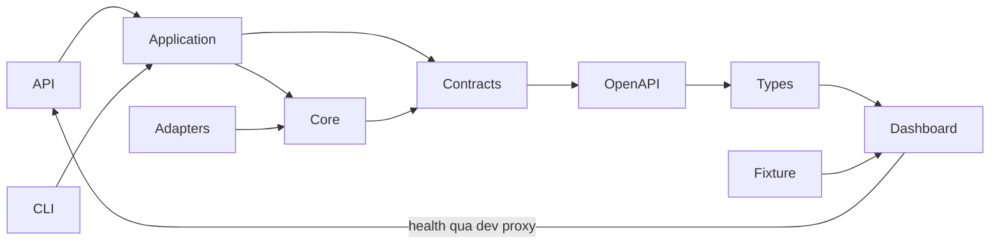

# Kiến trúc bootstrap

## Sprint 3 local product — 2026-11-15

The original bootstrap description below is retained as history. The accepted
phase3–8 implementation uses one React frontend, one FastAPI backend and
PostgreSQL. API → application → contracts/core/interfaces; storage/GitHub/parser/
Gemini/mail adapters are wired in composition. No input repository code is run by
the web process, and no Redis/broker/vector DB/microservice was added.

Cookie sessions/verified ownership and CSRF guard `/api/v1` product routes. Projects
own mutable run lifecycle, immutable canonical report links, scenarios, notes,
cached snapshots and activity. Background tasks share PostgreSQL slot/quota locks;
an exclusive backend lease protects restart recovery. AI is a separate reserved
request after static publication. Unknown billing remains reserved, not actual cost.
Dashboard view caches freeze summary and row predicates within repeatable-read.

Frozen forward migrations `_08`–`_15` add web domains without changing historical
research tables. Browser source is range-bound, local by default; external source
requires separate excerpt consent. Python and JS graphs are static facts; overlays
and hypotheses have distinct provenance. Caddy/PostgreSQL TLS packaging is local
only, with DDL confined to an explicit migration job. See
[operations/schema boundaries](../development/sprint-3-local-operations.md) and
[acceptance evidence](../development/sprint-3-phase-3-8-handoff.md).

Một monorepo, một Python package src-layout, một frontend. Không microservices,
Kubernetes, broker hoặc plugin framework. ADR bootstrap được viết trước khi tài liệu
C1.SE26 được thêm vào workspace. Scope/kiến trúc cấp cao hiện được đối chiếu với các
tài liệu đó; proposal ghi pending review và lựa chọn chưa chốt phải theo decision
register. Trang này mô tả implementation bootstrap, không tuyên bố hệ thống mục tiêu
đã triển khai.

Core không phụ thuộc entrypoint/SDK provider. Application dùng interface của core,
adapters triển khai kết nối ngoài; composition root ở api/main.py hoặc cli/main.py.
API dùng application health. [Task 2.13](../development/task-2.13.md) thêm CLI
`analyze` qua `composition.py` → shared application → frozen snapshots/changes/graph,
xuất stage report v2; downstream chưa triển khai giữ status rõ. Đây là read-only
local flow, không thêm analyze endpoint, input execution hoặc DB persistence.
CLI validation vẫn gọi application, không gắn nghiệp vụ vào argument parser.

Sprint 1 bổ sung [G1 harness](../../scripts/g1/README.md) làm composition root riêng
cho fixture: nối adapter Git, AST observations và Docker pytest spike. Đây không
phải luồng request của API/CLI; không mở rộng input support production từ smoke này.

Runner interface nằm tại core/execution/ports.py. Tương lai worker cô lập sẽ thực thi
repository code với timeout/resource/network policy; không chạy trong API/dashboard.
Một Git repository chứa nhiều executable entrypoint không có nghĩa chạy chung process.

Backend Pydantic models là nguồn chuẩn, export OpenAPI thêm các schema chưa có route.
Việc schema xuất hiện không có nghĩa API analyze đã tồn tại. Frontend types sinh bằng
openapi-typescript. Fixture duy nhất ở examples/reports được Python validate trong CI
trước build. Lệnh npm build riêng chỉ typecheck và bundle; khi đổi fixture phải chạy
CLI validate-report hoặc exporter trước, vì TypeScript không kiểm tra JSON ở runtime.

Source/retrieved text là dữ liệu không tin cậy, không được thay đổi policy/tool permissions.
Không có provider credential hoặc SDK trong bootstrap. Không log report input khi sai.
Selection chỉ được dùng thông tin có sẵn trước execution; outcome full-suite/fault label
phải tách sang evaluation để tránh rò rỉ ground truth.
