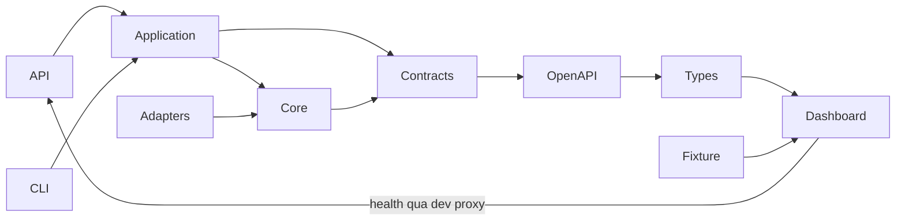

# Kiến trúc bootstrap

Một monorepo, một Python package src-layout, một frontend. Không microservices,
Kubernetes, broker hoặc plugin framework. ADR bootstrap được viết trước khi tài liệu
C1.SE26 được thêm vào workspace. Scope/kiến trúc cấp cao hiện được đối chiếu với các
tài liệu đó; proposal ghi pending review và lựa chọn chưa chốt phải theo decision
register. Trang này mô tả implementation bootstrap, không tuyên bố hệ thống mục tiêu
đã triển khai.

Core không phụ thuộc entrypoint/SDK provider. Application dùng interface của core,
adapters triển khai kết nối ngoài; composition root ở api/main.py hoặc cli/main.py.
Bootstrap chưa có orchestration analysis. API dùng application health; CLI dùng
application report validation, không gắn nghiệp vụ vào route/argument parser.

Sprint 1 bổ sung [G1 harness](../../scripts/g1/README.md) làm composition root riêng
cho fixture: nối adapter Git, AST observations và Docker pytest spike. Đây không
phải luồng request của API/CLI; không mở rộng input support production từ smoke này.

Runner interface nằm tại core/execution/ports.py. Tương lai worker cô lập sẽ thực thi
repository code với timeout/resource/network policy; không chạy trong API/dashboard.
Một Git repository chứa nhiều executable entrypoint không có nghĩa chạy chung process.

Backend Pydantic models là nguồn chuẩn, export OpenAPI thêm các schema chưa có route.
Việc schema xuất hiện không có nghĩa API analyze đã tồn tại. Frontend types sinh bằng
openapi-typescript. Fixture duy nhất ở examples/reports được Python validate trong CI
trước build. Lệnh npm build riêng chỉ typecheck và bundle; khi đổi fixture phải chạy
CLI validate-report hoặc exporter trước, vì TypeScript không kiểm tra JSON ở runtime.

Source/retrieved text là dữ liệu không tin cậy, không được thay đổi policy/tool permissions.
Không có provider credential hoặc SDK trong bootstrap. Không log report input khi sai.
Selection chỉ được dùng thông tin có sẵn trước execution; outcome full-suite/fault label
phải tách sang evaluation để tránh rò rỉ ground truth.
