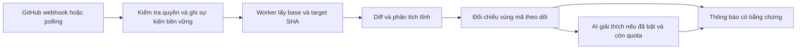

# Đề xuất: trợ lý giải thích repository và theo dõi thay đổi GitHub

Người dùng đã duyệt kế hoạch và giao thực thi ngày 19/11/2026. Nội dung bên dưới
giữ baseline lúc phân tích; xem [kế hoạch thực thi](repo-assistant-implementation-20261119.md)
và [handoff](repo-assistant-handoff-20261119.md) cho trạng thái triển khai/kiểm chứng.

- Ngày kiểm tra: 19/11/2026.
- Trạng thái: **accepted for local implementation** theo xác nhận user ngày
  19/11/2026; phần khảo sát dưới đây giữ baseline lúc đề xuất. Không tự cập nhật
  trạng thái sprint/task hoặc suy nghiệm thu nhóm từ quyết định triển khai.
- Baseline GitHub: main `effd115747a1260a8ebb7ef0f9d3ff9c0f88f1b1`, merge PR #70.
  Đã fetch và đối chiếu: cây source của main bằng HEAD local `292e2ee` tại thời điểm
  lập kế hoạch. Không checkout/reset hoặc ghi đè source local.
- Tài liệu này chỉ bổ sung kế hoạch; không thay quyết định ngôn ngữ MVP, ngân sách,
  schema, quyền GitHub hoặc trạng thái backlog hiện hành. Owner/reviewer chưa gán.

## 1. Kết luận và phạm vi nên chọn

Ba chức năng đều khả thi: giải thích dự án khi thêm URL, hỏi đáp có dẫn chứng và
thông báo thay đổi từ GitHub. Hướng phù hợp nhất là mở rộng trợ lý phục vụ
**đọc mã và đánh giá thay đổi**, dùng lại snapshot, graph, retrieval và AI hiện có.

Đề xuất bản đầu: repository GitHub public, Python là phạm vi phân tích ảnh hưởng
chính; tổng quan dự án, hỏi đáp theo commit, vùng mã người dùng theo dõi, kiểm tra
thay đổi thủ công và thông báo trong ứng dụng. Tự động theo dõi là bước tiếp theo.
Không gộp ngay đa ngôn ngữ đầy đủ, quản lý task/team, email/Slack và tự động chạy
test vào cùng một lần triển khai.

Giữ Python không cản trở chatbot. LLM có thể giải thích văn bản và nhiều ngôn ngữ,
nhưng khả năng đọc cú pháp khác khả năng chứng minh quan hệ ảnh hưởng. Không cần
train model mới chỉ để hỏi đáp repository; cần truy hồi đúng dữ liệu rồi cung cấp
cho provider hiện có. Chất lượng trả lời phải được đánh giá, không suy từ việc API
trả JSON hợp lệ.

## 2. Hiện trạng đối chiếu source

| Phần | Đã có | Phần phải bổ sung |
| --- | --- | --- |
| GitHub URL và project | [Acquisition public](../../backend/src/smartregression/adapters/github_repository.py), [project owner scope](../../backend/src/smartregression/application/projects.py), tree và immutable SHA | Onboarding tạo tổng quan; quyền tích hợp riêng nếu dùng webhook/private repo |
| Đọc và tìm mã | [Reading guide, lexical search](../../backend/src/smartregression/core/explorer/assistance.py), [snapshot/cache](../../backend/src/smartregression/application/explorer.py) | Tổng quan kiến trúc theo cấu trúc; truy hồi cho câu hỏi nối tiếp; đánh giá tìm kiếm tiếng Việt |
| AI | [Scoped assistance](../../backend/src/smartregression/application/assistance_ai.py), [run narrative](../../backend/src/smartregression/application/web_ai.py), [provider/citation validation](../../backend/src/smartregression/adapters/llm/repository_summary.py) | Hội thoại nhiều lượt, định tuyến câu hỏi và giải thích thay đổi gắn với vùng mã cá nhân |
| Impact và so sánh | [Python analysis runs](../../backend/src/smartregression/application/web_runs.py), [graph](../../backend/src/smartregression/core/explorer/graph.py), [scenario/version comparison](../../backend/src/smartregression/application/scenarios.py) | Phân tích thay đổi trên base và target cho câu hỏi cá nhân; xử lý xóa/đổi tên và ref thay đổi |
| Lưu trữ và UI | PostgreSQL, request/job state, quota, project activity, Explorer, saved reports | Subscriptions, event inbox, worker phục hồi, thông báo đọc/chưa đọc và hội thoại |

Không tìm thấy webhook receiver, remote-change scheduler hoặc persistent multi-turn
conversation trong source sản phẩm được kiểm tra. Project activity hiện ghi thao
tác sản phẩm; nó chưa phải feed sự kiện GitHub. AI actions hiện là các yêu cầu có
phạm vi riêng, không phải chatbot nhớ mọi câu hỏi trước đó.

Giới hạn đáng chú ý: assistance hiện ưu tiên metadata, tối đa 24 observations trong
bước thu thập chính, context có giới hạn byte và source excerpt cần consent riêng.
Output provider hiện giới hạn tối đa 8 findings. Không nên đổi nhãn reading guide
thành “giải thích toàn bộ dự án”; cần contract tổng quan phù hợp và truy hồi theo
từng mục, giữ hạn mức. Chi tiết hiện trạng và acceptance live còn giới hạn xem
[handoff](sprint-3-phase-3-8-handoff.md); các checkpoint cũ là lịch sử.

## 3. Luồng giải thích dự án khi thêm URL

1. Xác thực URL/quyền truy cập, resolve nhánh mặc định thành SHA cố định; không
   giả định repository nào cũng dùng tên `main`.
2. Nhập snapshot có giới hạn, lọc đường dẫn/nội dung theo policy; thu thập README,
   manifest, entrypoint, cấu trúc module và tests được phép. Những file chưa đủ
   điều kiện đọc phải được ghi rõ, không tự nới exclusion.
3. Hiển thị ngay tổng quan tĩnh và trạng thái xử lý. Nếu người dùng đã bật AI cho
   project, chấp nhận phạm vi dữ liệu gửi và còn quota, mới tạo tác vụ AI. Nếu chưa,
   cung cấp nút bật giải thích AI; nhập URL đơn thuần không thay consent hiện tại.
4. Trả overview ngắn, sau đó người dùng mở từng mục: mục đích theo tài liệu,
   stack/phụ thuộc, entrypoint quan sát được, module chính, luồng dữ liệu có căn cứ,
   nơi chứa tests và thứ tự đọc. Tách điều tài liệu mô tả khỏi điều source chứng minh.
5. Mỗi nhận định kỹ thuật kèm commit/path và dòng khi có. Cache theo owner/project,
   SHA, parser/retrieval/prompt/model config và chính sách dữ liệu. Không đưa toàn
   repository vào một prompt hoặc tạo lại cùng tổng quan khi tải lại trang.

“Chi tiết” nên là nội dung mở dần theo nhu cầu. Một đoạn trả lời rất dài ngay khi
thêm repo làm người dùng khó đọc và tăng chi phí mà chưa chắc tăng độ đúng.

## 4. Hỏi đáp và câu hỏi “có ảnh hưởng phần tôi làm không?”

### Ngữ cảnh bắt buộc

Người dùng chọn **vùng mã tôi theo dõi**: file/thư mục/module trong cùng project,
có thể thêm nhánh GitHub đang làm và baseline SHA. Có thể gợi ý bằng CODEOWNERS
hoặc Git history sau này, nhưng phải cho xác nhận. Email đăng nhập không chứng
minh GitHub identity, người được giao task hoặc quyền sở hữu mã.

Nhánh chưa push và thay đổi chưa commit trên máy cá nhân không có trên GitHub.
Bản đầu chỉ kết luận trên snapshot GitHub đã chọn; hỗ trợ patch/local workspace là
phạm vi riêng. CODEOWNERS cũng thể hiện người review, không chắc là người đang làm.

### Cách trả lời

- Câu hỏi tổng quan/file: truy hồi source/docs được phép của SHA đang xem.
- Câu hỏi thay đổi: xác định base/target SHA, diff và graph; lấy vùng thay đổi và
  reverse dependents rồi giao với vùng người dùng theo dõi. Dùng cả hai phía cho
  deleted/renamed paths và quan hệ bị xóa; không chỉ nhìn target graph.
- Nếu muốn hỏi tác động lên feature branch đã phân kỳ: phải resolve baseline,
  main mới và feature head/merge-base, ghi rõ semantics. Bản đầu chỉ hỗ trợ cùng
  repository; không giả định so sánh hai cây đồng nghĩa mô phỏng merge thành công.
- Trả các trạng thái: **sửa trực tiếp**, **có quan hệ ảnh hưởng tĩnh**,
  **chưa tìm thấy đường liên hệ trong phạm vi đã phân tích**, **chưa đủ dữ liệu**.
  Thiếu dữ liệu có thể đi cùng các quan hệ đã tìm thấy; không ép thành nhãn an toàn.
- Kèm chuỗi dependency, file/dòng, base/target và phần chưa biết; có thể mở subgraph
  nhỏ và diff. Mũi tên phải ghi rõ chiều import/call so với chiều lan truyền ảnh hưởng.
- Gợi ý kiểm tra tests hiện có khi inventory/mapping đã xác thực. Không tạo test ID
  tưởng tượng, coi graph là bằng chứng lỗi hoặc tự chạy source trong web process.

Ví dụ minh họa, không phải dữ kiện repo hiện tại: `billing.py` đổi và `checkout.py`
import nó; người dùng theo dõi `checkout.py`. Trợ lý có thể chỉ ra đường import và
hợp đồng hàm thay đổi. Nó chưa được nói “checkout chắc chắn hỏng” khi chưa có bằng
chứng hành vi. Ngược lại, không thấy edge cũng chưa đủ nói “không ảnh hưởng”.

Hội thoại phải gắn SHA; đổi commit cần mở ngữ cảnh mới hoặc explicit comparison.
Lượt trước giúp hiểu câu hỏi nối tiếp, không trở thành bằng chứng source. Lưu
message đã lọc theo retention policy và evidence references; không mặc định lưu
raw source/prompt. Cần đo câu hỏi tiếng Việt khác từ vựng code: lexical hiện có
không tự dịch. Chỉ thêm semantic retrieval khi đánh giá chứng minh còn thiếu.

## 5. Theo dõi GitHub và thông báo

AI giải thích dữ liệu được thu thập; GitHub integration mới là thành phần phát
hiện sự kiện. Luồng đề xuất:

| Tình huống | Xử lý nên có |
| --- | --- |
| Tạo branch | Ghi activity nếu người dùng đăng ký; không mặc định gọi AI vì có thể chỉ tạo ref trỏ tới code cũ |
| Push vào nhánh theo dõi | Gộp các push gần nhau, phân tích chênh lệch giữa SHA đã xử lý và SHA mới; giữ phạm vi gộp |
| PR chưa merge | Nếu bật theo dõi PR, ghi rõ đây là thay đổi đề xuất; không mô tả là đã có trên main |
| Merge PR | Kiểm tra closed + merged; phân tích thay đổi thật trên nhánh đích và liên kết PR, không phụ thuộc một merge strategy |
| Push trực tiếp main | Vẫn nhận qua push; không chỉ nghe pull_request |
| Merge sinh cả PR event và push | Đối chiếu delivery và identity phân tích để tránh hai thông báo cùng thay đổi |
| Force-push/xóa branch | Không giả định lịch sử tuyến tính; giữ SHA cũ, ghi rewound/deleted, xử lý thiếu object thành dữ liệu chưa đủ |

Mặc định theo dõi nhánh mặc định và vùng mã người dùng chọn; cho bật thêm nhánh.
Thông báo nên trả: ai thay đổi, nhánh/PR nào, base/target, file đáng chú ý, vùng
liên quan và nút mở diff/hỏi tiếp. “Không có vùng theo dõi bị chạm theo graph hiện
có” vẫn phải đi kèm coverage. Không mặc định gọi AI hoặc gửi cảnh báo cho mọi commit.

### Phương án nhận dữ liệu

**Giai đoạn local/demo:** kiểm tra thủ công trước, rồi polling có khoảng nghỉ,
ETag/conditional requests khi endpoint hỗ trợ, backoff/rate-limit và mốc lần đồng
bộ gần nhất. Khoảng trễ là cấu hình cần đo theo số repo và quota; polling có thể
bỏ lỡ branch tồn tại ngắn giữa hai lượt. Không cam kết ghi nhận mọi sự kiện.

**Giai đoạn vận hành:** GitHub App cài trên repo được cho phép; nhận create/push và
pull_request theo permissions tối thiểu. Một repository webhook được admin cấu
hình cũng là lựa chọn cho thử nghiệm một repo. Dán public URL không cấp quyền cài
App/webhook. Repo private cần luồng cấp quyền và acquisition adapter mới; hiện tại
adapter sản phẩm yêu cầu public repo.

Webhook cần HTTPS mà GitHub truy cập được, xác minh chữ ký trên raw body, kiểm
installation/repository/subscription và unique delivery ID. Ghi inbox/job bền vững
trước trả 2XX, xử lý nặng bằng worker; không giữ HTTP request chờ AI. Dedupe delivery
chưa đủ: phải dedupe tác vụ phân tích/thông báo theo owner/project/ref/base/target/
config, và đối soát khi webhook thiếu hoặc đến sai thứ tự.

Backend/worker phải hoạt động để theo dõi liên tục. Máy local tắt thì không có
giám sát liên tục; mở tab trình duyệt không thay thế scheduler. Khi bật lại, cần
đối soát head hiện tại và báo khoảng thời gian không quan sát được. Dùng lại
PostgreSQL và thêm inbox/job lease/recovery nếu cần; chưa có lý do buộc thêm Redis,
Kafka hoặc microservices. FastAPI BackgroundTasks hiện có không tự cung cấp durable
delivery/retry sau khi tiến trình chết.

## 6. Python hay đa ngôn ngữ?

| Năng lực | Phạm vi đề xuất |
| --- | --- |
| Nhận sự kiện GitHub, liệt kê file và diff | Không phụ thuộc ngôn ngữ |
| Giải thích README/config và code excerpt | Cho phép theo policy; ghi rõ mức hỗ trợ và dữ liệu đã đọc |
| Static impact và câu hỏi về phần mã cá nhân | Python ưu tiên; giữ partial/unknown với dynamic dispatch, cấu hình và phần ngoài phạm vi |
| Regression-test inventory/selection/execution | Giữ Python/pytest theo ADR 0002; không tự suy Jest/JUnit support |
| Explorer JavaScript hiện có | Giữ hỗ trợ literal `.js` ESM/CommonJS hiện có; không quảng bá thành hỗ trợ TypeScript hoặc phân tích Python–JS xuyên API |

Khuyến nghị: **giải thích rộng theo bằng chứng, phân tích sâu Python trước**.
Một repo có frontend/backend/SQL không thể được gọi là phân tích đầy đủ chỉ vì
LLM đọc được các file đó. Python cũng có giới hạn: DI, ORM, reflection, decorators,
runtime configuration và các cuộc gọi động cần coverage riêng.

Khi mở rộng, chọn một ngôn ngữ theo repo người dùng thực tế. Nếu chủ yếu React,
spike TypeScript/TSX là ứng viên hợp lý vì có `.js` adapter làm nền, nhưng vẫn cần
imports/aliases, tsconfig, framework conventions, call resolution, test discovery
và fixtures riêng. Quan hệ API Python–TypeScript hoặc schema SQL là adapter/hợp
đồng riêng, không tự xuất hiện từ hai parser. Không mở Java/C#/TS cùng lúc.

Chỉ nâng mức hỗ trợ sau khi có capability matrix, expected-edge/non-edge fixtures,
end-to-end cases và đánh giá lỗi. Chưa có capacity/schedule và dữ liệu nhu cầu,
nên chưa chốt thời gian triển khai hoặc coi đa ngôn ngữ là yêu cầu sprint hiện tại.

## 7. Kế hoạch triển khai và tiêu chí chấp nhận

Owner và reviewer của các gói dưới đây để **chưa gán**; thứ tự là dependency kỹ
thuật, không phải tự thêm mã task hoặc phân công vào Sprint 3.

| Gói | Đầu ra | Dependency và tiêu chí chấp nhận |
| --- | --- | --- |
| P0: Chốt contract và phạm vi | Capability matrix; question/overview/watch/notification contracts; policy dữ liệu/quota; fixtures | Public Python; cùng repo; static facts tách AI; owner scope; baseline/target rõ ràng; review schema/API trước producer/consumer |
| P1: Overview khi onboarding | Tổng quan tĩnh, AI opt-in, cache theo SHA/config; UI mở dần | P0; không block tạo project; lỗi/quota vẫn xem được tĩnh; citation mở đúng commit; reload không gọi lại; không gửi excerpt chưa consent |
| P2: Hỏi đáp và vùng mã cá nhân | Hội thoại theo snapshot; chọn vùng mã; diff/impact answer và subgraph | P1; câu hỏi nối tiếp đúng scope; xóa/rename dùng hai phía; không trộn SHA hoặc owner; thiếu evidence trả unknown; citation hợp lệ chưa được coi là đủ chứng minh semantics |
| P3: Check changes thủ công | Resolve nhánh; lưu baseline mới; delta report; in-app notification | P2; không có thay đổi không tạo alert; nhiều lượt cùng identity không trùng; main/feature khác biệt rõ; branch biến mất vẫn có trạng thái có nghĩa |
| P4: Tự động hóa | Polling local hoặc App/webhook vận hành; durable worker, dedupe, lease, reconciliation | P3 và quyền/hạ tầng phù hợp; duplicate/out-of-order events, push+merge, force-push, crash/restart, outage/rate-limit được kiểm thử; ngắt subscription dừng theo dõi |
| P5: Đánh giá và mở rộng | Đo retrieval/answer quality, tải/chi phí; spike ngôn ngữ kế tiếp nếu cần | Python slice đạt các gate; báo rõ corpus/sample và giới hạn; quyết định riêng trước đổi scope language/test framework |

Mốc demo nhỏ nhất có giá trị là **P0–P3**: thêm URL → đọc tổng quan → hỏi về vùng
mã → kiểm tra main mới → thấy thông báo và bằng chứng. P4 làm sau khi vòng phân
tích đã đúng, tránh tự động hóa việc gửi nhiều kết luận chưa kiểm chứng.

### Tác động kiến trúc/dữ liệu dự kiến, chưa triển khai

- Giữ React/FastAPI/PostgreSQL và provider adapter hiện có; logic nghiệp vụ ở
  application, graph/retrieval ở core, GitHub/provider/storage ở adapters.
- Nhóm dữ liệu logic: watch/subscription (vùng mã, ref, baseline, owner), event
  inbox và job (delivery key, SHAs, lease, attempts), notification (report/evidence
  reference, read state), conversation/message/context manifest. Chỉ chốt tên bảng
  và migration sau kiểm tra constraints/retention, không sửa migration cũ.
- API mới dự kiến cho overview, thread/messages, watches/check-now và notifications.
  Webhook là endpoint riêng dùng chữ ký, không dùng CSRF của phiên trình duyệt;
  user APIs vẫn giữ auth/owner/CSRF. Contract mới phải export OpenAPI/TS và cập nhật
  consumer bằng tooling hiện có.
- Existing AI action enum/schema và campaign constraints không đáp ứng một chatbot
  thường trực bằng đổi nhãn UI. Cần thiết kế quota/cost riêng có giới hạn đã chốt;
  không tái sử dụng hoặc nới chiến dịch acceptance đã hết lượt.
- Không thêm quyền ghi source/commit/merge hoặc thực thi input code cho chatbot.
  Ngữ cảnh từ source/comment/docs vẫn là dữ liệu không tin cậy. Source egress,
  message retention và truy cập repo private phải được quyết định trước live use.

### Kiểm chứng cần có trước nghiệm thu

1. Fixtures có đáp án đối chiếu cho overview, import chain, alias/re-export, shadow,
   thay đổi config, deleted/renamed code và trường hợp cố ý không có quan hệ.
2. Câu hỏi thật bằng tiếng Việt: câu nối tiếp, câu mơ hồ, sai premise, không có dữ
   liệu và đổi commit; đo retrieval tìm đúng context và câu trả lời có được evidence
   hỗ trợ. Dẫn đúng file không đồng nghĩa kết luận đúng.
3. Integration GitHub synthetic trước: chữ ký sai, repo/installation sai, delivery
   trùng, event đến đảo thứ tự, merge tạo hai loại event, force-push và object thiếu.
4. PostgreSQL thật: owner isolation, unique jobs/notifications, atomic reservation,
   lease recovery, restart và backup/restore của dữ liệu mới.
5. UI/API: loading/empty/error/quota, read/unread, light/dark, keyboard/mobile,
   SHA switching và citation/diff/subgraph đúng nguồn.
6. Live GitHub webhook/provider chỉ trong môi trường, quyền dữ liệu và budget đã
   chốt; ghi độ trễ, usage/cost thực hoặc unknown. Không lấy mock làm live acceptance.

## 8. Những lựa chọn cần chốt trước build

Đề xuất mặc định để nhóm duyệt: public repo trước; Python impact trước; AI tổng
quan bật theo project sau consent; người dùng chọn vùng mã; thông báo trong app;
manual check trước polling; GitHub App sau khi có hạ tầng phù hợp. Private repo,
multi-user/team work ownership, email/Slack, đa ngôn ngữ sâu và tự chạy tests nằm
ngoài slice đầu. Cần thêm budget AI và nơi chạy backend/worker trước tự động hóa.

Đây là các quyết định sản phẩm/triển khai còn đề xuất, không phải yêu cầu phải trả
lời để hoàn thành bước phân tích hiện tại. Nhóm có thể review kế hoạch trước khi
cập nhật Product/Sprint Backlog và tài liệu Database/Architecture tương ứng.

## 9. Nguồn và kiểm tra tài liệu

- [ADR 0002: Python/pytest](../architecture/decisions/0002-python-pytest-input.md).
- [ADR 0003: structural + lexical retrieval](../architecture/decisions/0003-local-lexical-retrieval.md).
- [Python coverage/resolution handoff](python-analysis-scope-20261118.md).
- [GitHub commit main đã đối chiếu](https://github.com/kokoreina/smartregression-ai/commit/effd115747a1260a8ebb7ef0f9d3ff9c0f88f1b1).
- [GitHub webhook events/payloads](https://docs.github.com/en/webhooks/webhook-events-and-payloads): create/push/pull_request và permissions.
- [Webhook best practices](https://docs.github.com/en/webhooks/using-webhooks/best-practices-for-using-webhooks): secret, HTTPS, delivery ID, phản hồi trong 10 giây và xử lý bất đồng bộ.
- [REST best practices](https://docs.github.com/en/rest/using-the-rest-api/best-practices-for-using-the-rest-api): conditional GET, ETag và rate limits.

Các trang GitHub Docs trên đã truy cập ngày 19/11/2026. Chỉ kiểm tra source,
baseline Git và tài liệu trong phiên này; không chạy lại product suite cho thay
đổi Markdown, không thử chatbot/webhook chưa triển khai hoặc gọi provider.

AI disclosure: Codex hỗ trợ đọc source, đối chiếu nguồn, phân tích khả thi và soạn
kế hoạch này. Đã đối chiếu Appendix C/D của [Proposal v1.4](../../C1.SE26_DOCUMENTS/C1SE26_SmartRegression_AI_Proposal_Merged_v1.4.docx).
Nhóm cần review, hiểu và xác minh trước khi dùng làm thiết kế hoặc báo cáo; không
suy phê duyệt mentor, independent review hay tỷ lệ đóng góp từ tài liệu này.
