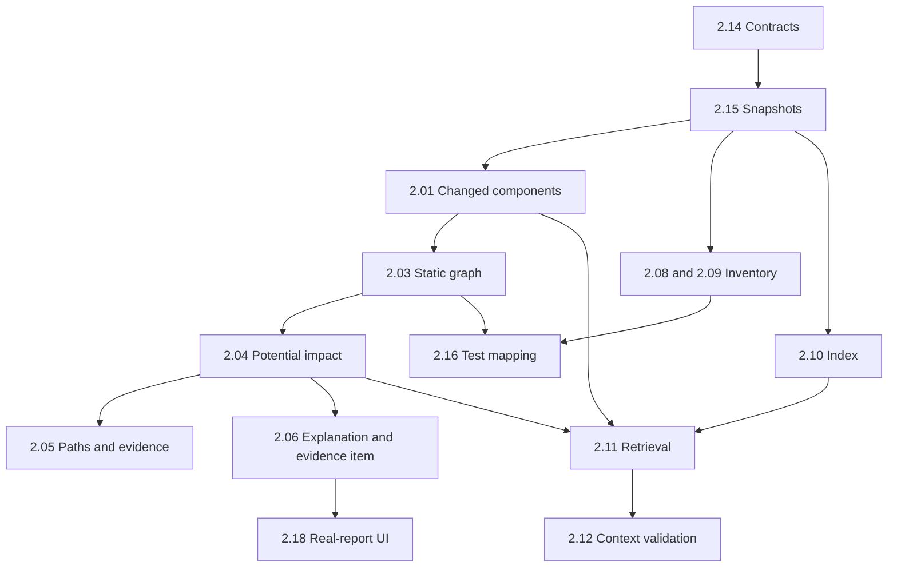

# Sprint 2 team guide — SmartRegression AI

Ngày đối chiếu: **2026-10-31**. Mục tiêu: **Change impact + dependency analysis +
RAG retrieval core**. Đây là hướng dẫn thực thi kế hoạch hiện hành; task scope,
phân bổ giờ và reviewer trong workbook vẫn là **proposed**, chưa phải cam kết
capacity, nghiệm thu của nhóm hoặc phê duyệt mentor.

**PostgreSQL đã được người dùng chốt ngày 2026-10-31.** Python/FastAPI giữ nguyên.
ORM/driver, migration tool, minimum schema và retrieval/embedding backend còn
pending. Guide này không tự lựa chọn chúng và không chứng minh đã có DB integration.

## 1. Bắt đầu trong một phiên làm việc

1. Tìm tên tại [hướng dẫn thành viên](#members), chọn **một task hoặc support slice**
   đã được giao. Đọc [brief tương ứng](#tasks), không giao toàn bộ sprint cho agent.
2. Kiểm tra repository root, `git status --short`, hướng dẫn `AGENTS.md` áp dụng theo
   thư mục và thay đổi có sẵn. Làm trên checkout/branch riêng theo quy trình nhóm;
   không ghi đè, reset hoặc dọn file của người khác.
3. Xác định dependency nào cần **thiết kế/interface**, dependency nào cần
   **implementation**, và quyết định/môi trường nào thực sự chặn task.
4. Điền [task brief][task-template]: scope, AC, paths, quyền, shared writer,
   kiểm chứng và đầu ra cần bàn giao. Dùng [prompt bắt đầu](#prompt-start) và prompt
   cá nhân; agent phải mở đúng profile/rules/`SKILL.md` theo [routing](#routing).
5. Thực hiện phần được giao, kiểm tra phù hợp và ghi kết quả thật. Thiếu quyết định
   thì tiếp tục phần độc lập; không âm thầm thay stack, giả output hoặc bỏ gate.
6. Tự kiểm tra diff, nhờ reviewer khác review và bàn giao theo [handoff][handoff].
   Tự kiểm tra trong cùng phiên phải ghi **self-review**.

Guide, profile, rules và skills là tài liệu hướng dẫn; chúng không cấp quyền tools,
đổi model hoặc tự khởi chạy sub-agent. Việc nhắc tên skill không chứng minh agent
đã đọc nó. Yêu cầu agent nêu paths thực sự đã mở, quy tắc áp dụng và checks thực tế.
Không giả mọi IDE/client tự nạp cả bộ; xem [agent rules setup][agent-setup].

Quyền sửa local/checks đến từ task cụ thể. Không tự commit/push/merge/deploy, thay
quyền GitHub, thêm provider hoặc gọi dịch vụ trả phí. Không xem open PR trong
phạm vi làm việc này. Không cần xin phép lại các bước cục bộ đã được giao hợp lệ.

## 2. Nguồn, hiện trạng và giới hạn

### 2.1. Nguồn có thẩm quyền theo loại thông tin

| Nguồn | Phần sử dụng | Cách hiểu |
| --- | --- | --- |
| [Scrum workbook hiện hành][workbook] | `Sprint 2 Backlog!B8:G27`, brief hàng 55–174, phân bổ hàng 184–210; `Sprint 2 Reports!B7:Z55`; Product Backlog/Main | Nguồn kế hoạch, AC, giờ và phân công. Phân biệt task estimate với PB estimate và actual effort |
| [AGENTS.md][agents], [governance][r00], [decision register][decisions] | Routing, quyền, trạng thái quyết định và pending | Đọc cùng quyết định mới; không coi câu lịch sử là hiện trạng bất biến |
| [Proposal v1.4][proposal] | §11.2–11.3, Appendix C/D | Mục tiêu, AI disclosure và trách nhiệm tác giả; chữ ký lịch sử không phê duyệt guide mới |
| [Project Plan v1.1][project-plan] | Sprint 2 schedule, workstreams và resource assumptions | Lịch/estimate lịch sử không xác nhận capacity cho kế hoạch sửa đổi |
| [Architecture v1.3][architecture-doc], [Database v1.5][database-doc] | Impact/retrieval boundaries; DB §3 và các FK prerequisite | Thiết kế để đối chiếu; không tự mở rộng scope implementation |
| [Sprint 1 guide][sprint1], [closeout handoff][closeout], [module ownership][ownership] | Bài học phối hợp, evidence và vùng trách nhiệm | Không sao chép trạng thái README-only/pending cũ mà bỏ qua code mới |
| Source/manifests/scripts và [verified commands][commands] | Implementation và định nghĩa lệnh | Có code/lệnh không đồng nghĩa đã chạy thành công trong phiên này |

Office được đọc ở mức dữ liệu ô XLSX và text/bảng DOCX liên quan, gồm Appendix C/D.
Không tính lại workbook bằng Excel, kiểm layout/sơ đồ nhúng hoặc xác minh mọi nguồn
nghiên cứu bên ngoài trong nhiệm vụ tạo guide. Không dùng bản xuất tạm làm baseline.

### 2.2. Trạng thái xuất phát đã đối chiếu source

| Trạng thái | Bằng chứng và hệ quả cho Sprint 2 |
| --- | --- |
| Bootstrap đã có | [Canonical models][models], application validation, [API health][health-route], [CLI][cli], React/TypeScript và schema/type generation. API health chỉ phản ánh service |
| Spike Sprint 1 đã có | [Local Git adapter][git-local], [Python AST snapshot][python-snapshot], [access/lifecycle prototype][prototypes]. AST chỉ quan sát imports và thay đổi text span; chưa phải graph/impact hoàn chỉnh |
| Harness có phạm vi hẹp | [G1 fixture harness][g1], [candidate harness][candidates], [pytest spike adapter][pytest-spike]. G1 chỉ fixture tự tạo; candidate harness chỉ hai repo/SHA cố định. Không dùng chúng như runner arbitrary repository |
| UI DEMO | [App][app], [ReportView][report-view], fixture và health consumer. Chưa có flow mở stage report thực của Sprint 2 |
| Chưa có pipeline Sprint 2 | Chưa có production snapshot/index/retrieval/mapping/persistence workflow. [Storage][storage] và [retrieval][retrieval] còn README; [runner port][runner-port] không phải worker production |
| Contract cần reconcile | `AnalysisReport` hiện bắt buộc `selection`; CLI chỉ có `validate-report`. Task 2.14 phải thiết kế stage reports, không điền selection/execution giả để hợp schema |

Đây là kiểm tra source, không phải kết quả chạy lại product tests hay xác nhận CI
cho thay đổi mới. Kết quả Sprint 1 trong handoff/verified-commands là bằng chứng lịch sử.

### 2.3. Các điểm tài liệu còn lệch trạng thái

- [Decision register][decisions] D06, [rule 04][r04] và Architecture còn mô tả DB
  pending; riêng **DB engine** đã được thay bằng quyết định PostgreSQL từ người dùng,
  được ghi tại `Sprint 2 Reports!E11`. Tooling/schema/retention vẫn cần quyết định.
- [Agent setup][agent-setup] và phần lịch sử [verified commands][commands] còn ghi
  không có Git. Phiên đối chiếu này có Git, branch
  `work/sprint-1-local-closeout-20261031`, HEAD `3d9f98b`; phải kiểm lại ở phiên sau.
- Profile/rule có câu chưa có parser/runner/thuật toán là snapshot cũ: hiện đã có
  spike nêu trên. Các yêu cầu kiến trúc, provenance và security trong cùng file vẫn
  áp dụng; không vô hiệu hóa cả rule.
- [Revision semantics][revision] Q01–Q10 cần review theo
  `Sprint 2 Reports!E47`; merge code không tự chốt mọi policy. Hai commit đóng băng
  khác với việc tự chọn merge-base hoặc triển khai live PR ingestion.

Chỉ guide này được cập nhật trong nhiệm vụ hiện tại. Việc đồng bộ decision register,
setup/rules và DOCX là follow-up có phạm vi riêng, không sửa ngầm nguồn khác.

### 2.4. Scope và đầu ra

Đầu vào là repository **Python/pytest được phép xử lý**, base/target full commit SHA
đã đóng băng. Đầu ra gồm changed components, graph/paths potential impact, evidence,
target inventory, component-to-existing-test mapping, snapshot retrieval/provenance,
application workflow/CLI/stage reports, UI tối thiểu và PostgreSQL foundation.

Ngoài Sprint 2: full LLM selector, production execution platform, benchmark/history
dashboard đầy đủ, full dataset, input-repo CI integration và sinh test/sửa code repo
đầu vào. Vẫn viết test cho **SmartRegression**. Hoàn thành task con không đồng nghĩa
hoàn thành toàn bộ PB được trace tới nó.

## 3. Kế hoạch và phân bổ giờ

**232h công việc + 32h dự phòng = 264h nhu cầu kế hoạch.** Capacity và sprint
commitment thực tế chưa xác nhận. Dự phòng không cộng lần hai unit tests, integration
hoặc debugging đã nằm trong estimate task. Không chia reserve cho từng người như
thể đã được giao.

| Mã | Thành viên | Giờ công việc | Điểm cần phối hợp |
| --- | --- | --- | --- |
| H1 | Nguyen Tan Huy | 50 | Contract, application, evidence và PostgreSQL connection |
| AN | Do Ha An | 40 | Snapshot, changed components, limitations và identity regressions |
| H2 | Pham Phan Hoang Huy | 52 | Graph, reverse impact, index và retrieval |
| KH | Tran Hung Khanh | 50 | Inventory, mapping, migrations/integration và exclusions |
| VI | Dang Dai Viet | 40 | Independent validation, ordering, retrieval validation và UI |
| Tổng | 5 thành viên | 232 | 32h reserve riêng; actual capacity pending |

Hai người tên Huy luôn dùng họ tên đầy đủ trong prompt/handoff. Accountable owner
không nhất thiết thực hiện toàn bộ effort của task. Bảng dưới dùng **giờ từng người**;
tổng mỗi hàng bằng estimate task. Reviewer đều chưa được xác nhận nhận việc.

<a id="tasks"></a>
### 3.1. Tổng quan 20 task

PB tại cột dưới ưu tiên traceability chi tiết trong brief workbook; ví dụ 2.14 có
PB04 ở bảng chính nhưng brief liệt kê thêm các PB producer/consumer liên quan.

| Task / PB | Công việc và deliverable | Accountable | Phân bổ | Reviewer đề xuất | Dependency chính |
| --- | --- | --- | --- | --- | --- |
| [2.01](#task-201) / PB05 | Changed file/module/class/function records | AN | AN 20h | Pending | 2.14, 2.15 |
| [2.02](#task-202) / PB05 | Expected locations và mismatch record độc lập | VI | VI 8h | Pending | 2.01, 2.14 |
| [2.03](#task-203) / PB06 | Static graph có semantics/phạm vi | H2 | H2 16h | Pending | 2.01, 2.14, 2.15 |
| [2.04](#task-204) / PB06 | Direct/indirect candidates và paths | H2 | H2 12h | Pending | 2.03, 2.14 |
| [2.05](#task-205) / PB06 | Paths/evidence persistence | H1 | H1 8h | Pending | 2.04, 2.14, checkpoint 2.20 |
| [2.06](#task-206) / PB07 | Explanation payload + evidence-item component | H1 | H1 6h; VI 6h | Pending | 2.04, 2.14; 2.05 cho persisted inspection |
| [2.07](#task-207) / PB08 | Manual-review ordering ổn định | VI | VI 8h | Pending | 2.01, 2.04, 2.14 |
| [2.08](#task-208) / PB09 | Isolated target inventory | KH | KH 12h | Pending | 2.14, 2.15; 2.20 cho durable inventory |
| [2.09](#task-209) / PB09 | Empty/partial/failed discovery rõ ràng | KH | KH 6h | Pending | 2.08, 2.14 |
| [2.10](#task-210) / PB19 | Snapshot index và chunk manifest | H2 | H2 12h; KH 4h | Pending | 2.14, 2.15, retrieval decision, checkpoint 2.20 |
| [2.11](#task-211) / PB20 | Context theo diff/candidates có provenance | H2 | H2 12h | Pending | 2.10, 2.01, 2.04, 2.14 |
| [2.12](#task-212) / PB20 | Ranked/deduplicated/validated context | VI | VI 8h | Pending | 2.11, 2.14 |
| [2.13](#task-213) / PB04 | Application workflow, CLI, smoke/demo | H1 | H1 12h | Pending | 2.14; tích hợp từng stage khi có |
| [2.14](#task-214) / PB04/PB05–09/PB19/PB20 | Stage contracts được producer/consumer review | H1 | H1 12h | AN, VI | Contracts và quyết định Sprint 1 |
| [2.15](#task-215) / PB03; hỗ trợ PB05/PB19 | Authorized immutable snapshots | AN | AN 10h | KH | Identity contract 2.14, revision policy |
| [2.16](#task-216) / PB06/PB09; chuẩn bị PB22 | Component → existing target test IDs | KH | KH 8h | H2 | 2.03/04, 2.08/09, 2.14 |
| [2.17](#task-217) / PB06/PB07/PB09/PB20 | Analysis-scope/limitations manifest | AN | AN 6h; KH 4h | H1 | Thiết kế 2.14; nối từng stage |
| [2.18](#task-218) / PB05/PB07 | Real-report loading/navigation/states | VI | VI 10h | H1 | 2.14, component 2.06, stage outputs thật |
| [2.19](#task-219) / Integration | Cross-module failure regressions | KH | AN 4h; KH 4h | VI | Expectations 2.14, integrated boundaries 2.13 |
| [2.20](#task-220) / hỗ trợ PB04/06/09/19/20 | PostgreSQL foundation giới hạn | H1 | H1 12h; KH 12h | AN | 2.14, minimum-schema/tooling checkpoint |

Trong workbook, bảng task/brief vẫn là kế hoạch và các task đang `Not started`.
Daily completed-estimate entries phục vụ burn-down khác actual worked-hour logs;
không điền actual effort vào cột completed estimate. Không có progress/accuracy mới
được đo chỉ bằng việc viết guide.

## 4. Dependency, checkpoint và tích hợp

Trình tự ba tuần dưới đây là **đề xuất tương đối**, theo `Sprint 2 Reports!E22:E25`;
không tạo ngày bắt đầu/kết thúc mới từ lịch cũ.

| Mốc | Công việc chính | Đầu ra cần được review để mở khóa |
| --- | --- | --- |
| Tuần 1 | H1 mở 2.14 và thin flow 2.13; AN mở 2.15/thiết kế 2.17; H1/KH checkpoint 2.20; H2 làm rõ retrieval; VI chuẩn bị oracle độc lập 2.02 | Identity/schema examples, stage statuses, interface persistence, minimum-schema và retrieval decisions. Chốt writer cho shared files |
| Tuần 2 | 2.01 → 2.03 → 2.04 → 2.05/06; 2.08/09 + graph → 2.16; 2.10 → 2.11 → 2.12; 2.07 dùng changed/impact | Từng producer bàn giao fixture/AC và output đúng identity; nối domain persistence vào PostgreSQL foundation khi sẵn sàng |
| Tuần 3 | 2.18 mở report thực; 2.19 kiểm failure xuyên module; reproduction/demo 2.13; human review | Actual stage reports, PostgreSQL evidence, regression results, limitations và pending được ghi trung thực |

2.17 được thiết kế sớm và cập nhật liên tục. 2.13 không chờ mọi stage xong mới bắt
đầu; thin flow chưa triển khai phải báo `not_implemented`/trạng thái tương ứng đã
thống nhất, không giả một lần phân tích thành công.



Sơ đồ chỉ thể hiện chuỗi dữ liệu chính. Contracts 2.14, limitations 2.17 và workflow
2.13 xuyên các stage; PostgreSQL checkpoint phục vụ các persistence consumers theo
bảng task. Không diễn giải mỗi mũi tên là phải chờ toàn bộ task trước hoàn tất.

### 4.1. Phân loại dependency

- **Thiết kế/interface:** có thể soạn expected fixtures, pure logic, payload examples
  và unit tests khi interface đã được thống nhất, dù adapter thật chưa xong.
- **Implementation:** persisted inspection cần write/read thật; real-report UI cần
  stage output thật; cross-module tests cần các boundary thực đã nối.
- **Quyết định:** không chọn ORM/driver, migration hoặc retrieval backend thay nhóm.
  Lập phương án/tradeoff và tiêu chí kiểm chứng; chỉ tiếp tục phần không phụ thuộc.
- **Môi trường:** thiếu PostgreSQL/Docker/quyền dữ liệu thì ghi bước integration
  bị chặn; không chạy input code trên host hoặc dùng mock làm evidence integration.

### 4.2. Shared files và ranh giới chống làm trùng

| Vùng dùng chung | Điều phối theo task | Quy tắc bàn giao |
| --- | --- | --- |
| [Models][models], exported schema/types, fixture | H1 theo 2.14; producer và AN/VI review đề xuất | Thống nhất identity, statuses, version/compatibility trước; một writer cho cùng thay đổi; regenerate bằng công cụ |
| PostgreSQL connection/config/transaction foundation | H1 theo 2.20 | H1/KH chốt interface và tooling; adapter không làm core phụ thuộc DB driver |
| Migration mechanism và schema chain | KH theo support slice 2.20, phối hợp H1 | Chỉ một writer cho cùng migration/schema chain tại một thời điểm; domain owner cung cấp schema requirements và tests |
| Domain persistence | H1 2.05; KH 2.08; H2 2.10 | Tái sử dụng foundation. Không tính lại giờ xây connection/migration infrastructure trong từng task |
| Explanation và evidence UI | H1 payload/validation 6h; VI component 6h trong 2.06 | 2.18 tái sử dụng component, phụ trách loading/navigation/states; không viết lại evidence component |
| Workflow và regression xuyên module | H1 2.13; KH/AN 2.19 | 2.13 wiring/smoke/demo; 2.19 identity/inventory failure regressions; unit tests vẫn thuộc từng task |
| Manifest limitations | AN 2.17; KH inventory propagation 4h | Mỗi producer ghi reason; application/UI bảo toàn partial/error, không làm mất ở bước tổng hợp |

Điều phối theo task không cấp độc quyền module hoặc tự xác nhận người review đã
nhận việc. Trước khi sửa shared file, ghi task/writer/base đang dùng, output cần đổi
và consumer; bàn giao diff/checks rồi mới chuyển writer. Không sửa generated types
hoặc lockfiles bằng tay; không đổi version/contract bằng cast frontend.

<a id="routing"></a>
## 5. Routing profile, rules và skills

Mở [AGENTS][agents] trước, rồi hàng phù hợp. Số rule trong từng brief dưới đây trỏ
đến bảng này; không yêu cầu mọi task đọc toàn bộ catalog. Governance 00 cần đọc
khi có xung đột scope/quyết định; documentation 13 áp dụng khi đổi docs/handoff.

| Route / loại việc | Profile | Rules phải mở theo việc | Skill theo trigger |
| --- | --- | --- | --- |
| <a id="route-coordinator"></a>Coordinator | [Coordinator][profile-coordinator] | [00][r00], [01][r01], [05][r05], [13][r13] | Không cần skill chỉ để chia task |
| <a id="route-backend"></a>Backend / contracts / persistence | [Backend/Contracts][profile-backend] | [02][r02], [03][r03], [06][r06]; thêm [01][r01]/[04][r04] khi persistence | [api-contracts][skill-contracts] khi đổi producer-consumer contract; [security-review][skill-security] khi trust boundary/input/secret |
| <a id="route-impact"></a>Git / snapshot / components / graph / evidence | [Change Impact][profile-impact] | [01][r01], [09][r09], [06][r06]; [10][r10] khi ingest | Security khi path/shell/untrusted input; [TDD][skill-tdd] khi behavior có focused regression test |
| <a id="route-runner"></a>Runner / discovery / dependency | [DevOps/Runner][profile-runner] | [10][r10], [12][r12], [06][r06]; [14][r14]/[05][r05] khi review CI | Security cho execution/isolation; [github-actions-hardening][skill-actions] chỉ khi task chạm workflow |
| <a id="route-inventory"></a>Inventory / mapping | [Regression Selection][profile-selection] | [03][r03], [09][r09], [06][r06] | Contracts khi shared shape đổi; TDD cho mapping/validation behavior. Không triển khai selector ngoài task |
| <a id="route-rag"></a>Index / retrieval / context | [RAG/LLM][profile-rag] | [04][r04], [08][r08], [06][r06]; [09][r09] khi impact/evidence; [03][r03] khi contract | Security cho source/prompt/provenance; contracts khi đổi output; TDD cho deterministic behavior |
| <a id="route-ui"></a>Report UI | [Frontend/Dashboard][profile-ui] | [02][r02], [03][r03], [06][r06] | [ui-design][skill-ui] khi thiết kế view; [accessibility-review][skill-a11y] khi semantics/keyboard/focus/contrast; [webapp-testing][skill-browser] khi cần browser |
| <a id="route-qa"></a>Correctness / research | [QA/Research][profile-qa] | [06][r06], [11][r11]; thêm rule module | TDD khi behavior test-first; [evaluation-integrity][skill-evaluation] chỉ khi dataset/labels/baselines/metrics/research claims; [ux-research][skill-ux] nếu thực sự có usability study |
| <a id="route-review"></a>Review | [Reviewer][profile-review] | [05][r05], [14][r14], [06][r06] và rule module | Skill theo rủi ro cụ thể; review mặc định chỉ đọc |
| <a id="route-debug"></a>Debug | Profile module | Thêm [07][r07] | [systematic-debugging][skill-debug]; TDD nếu có regression test phù hợp |

Skills là workflow nội bộ có nguồn tham khảo, không mặc định là upstream package
đã pin commit. Không có PostgreSQL-specific skill trong catalog hiện tại. Đọc
`SKILL.md` đúng trigger; skill browser cần tool và môi trường thực sự có sẵn.

## 6. Task briefs

AC dưới đây tóm lược trung thành từng brief workbook; tọa độ nguồn cho phép đối
chiếu nguyên văn. Những mục ghi **đề xuất bổ sung** là hướng dẫn kiểm chứng trong
scope, không đổi estimate hoặc tự mở rộng cam kết. Paths liên kết là **đang tồn tại**;
implementation mới bên trong các vùng đó là **dự kiến**, chưa phải feature đã có.

<a id="task-201"></a>
### 2.01 — Changed components

- **Nguồn/nhân sự:** `Sprint 2 Backlog!B55:Z59`; PB05; AN 20h, accountable AN;
  reviewer pending.
- **Input/dependency:** 2.14 identity/shape checkpoint và 2.15 immutable base/target.
  Thiết kế fixtures độc lập trước; end-to-end cần snapshot implementation.
- **Output/consumer:** file/module/class/function records → 2.02/03/07/11/17.
  Paths: [Git adapter][git-local], [AST spike][python-snapshot], [core impact][impact],
  [backend tests][tests]; extension application/core dự kiến theo interface.
- **AC:** add/modify/delete/rename có previous path; đúng granularity; mọi location
  resolve ở commit base/target đã khai báo; unsupported syntax là partial.
- **Kiểm chứng/bàn giao:** fixtures với expected changes độc lập và immutable Git
  blobs; deletion/rename/dirty-tree isolation; output kèm identity/limitations và
  lệnh/kết quả theo [backend checks](#checks-backend).
- **Routing/rủi ro:** [Impact](#route-impact), contracts nếu đổi shape, security khi
  ingest. Không chạy/import input module; deleted location có thể chỉ tồn tại ở base.

<a id="task-202"></a>
### 2.02 — Independent changed-location validation

- **Nguồn/nhân sự:** `Sprint 2 Backlog!B61:Z65`; PB05; VI 8h, accountable VI;
  reviewer pending.
- **Input/dependency:** shape 2.14 và output 2.01; có thể chuẩn bị expected records
  trước khi nhận output, tránh tạo oracle từ chính kết quả cần kiểm.
- **Output/consumer:** fixture revisions, expected ranges và mismatch/unresolved
  record → AN sửa producer, H1 tích hợp/review. Paths: [tests][tests],
  [fixtures][fixtures], đọc [AST spike][python-snapshot].
- **AC:** đối chiếu components/ranges độc lập; reject sai commit/path/span; giữ
  disagreement và unresolved labels. Dependency reachability không là ground truth.
- **Kiểm chứng/bàn giao:** positive/wrong-location cases; expected/actual, mismatch
  evidence, commands/results. Đề xuất bổ sung: giữ oracle riêng với observed output.
- **Routing/rủi ro:** [QA](#route-qa) + [Impact](#route-impact) cho location semantics.
  Evaluation-integrity chỉ khi mở rộng sang labels/metrics nghiên cứu; task này không
  tự tạo benchmark accuracy hoặc tự tính là review độc lập của tác giả 2.01.

<a id="task-203"></a>
### 2.03 — Supported static dependency graph

- **Nguồn/nhân sự:** `Sprint 2 Backlog!B67:Z71`; PB06; H2 16h, accountable H2;
  reviewer pending.
- **Input/dependency:** 2.01, 2.14, 2.15; chốt component identity, graph snapshot và
  edge direction trước implementation liên module.
- **Output/consumer:** components/edges + supported/unresolved semantics → 2.04/16/17.
  Paths: [core impact][impact], [AST spike][python-snapshot], [tests][tests].
- **AC:** mô tả supported import/reference semantics và edge direction; endpoints
  cùng repository/snapshot; relative/star/dynamic imports được hỗ trợ có evidence
  hoặc ghi unresolved. Không quảng cáo call graph đầy đủ từ import spike.
- **Kiểm chứng/bàn giao:** expected-edge fixtures độc lập cho supported/unsupported
  imports và wrong-snapshot endpoints; graph examples/limits và backend results.
- **Routing/rủi ro:** [Impact](#route-impact), contracts nếu shared shape đổi, TDD.
  Thiếu edge không được hiểu là không có dependency hoặc an toàn để bỏ test.

<a id="task-204"></a>
### 2.04 — Reverse-reachable potential impact

- **Nguồn/nhân sự:** `Sprint 2 Backlog!B73:Z77`; PB06; H2 12h, accountable H2;
  reviewer pending.
- **Input/dependency:** graph 2.03 và contract 2.14.
- **Output/consumer:** changed/direct/indirect candidates cùng paths → 2.05/06/07/11/16.
  Paths: [core impact][impact], [tests][tests]; implementation traversal dự kiến.
- **AC:** traverse chiều reverse dependency từ changed components; phân biệt loại
  candidate; cycle terminate; paths dedup deterministic. Reachability là potential
  impact, chưa xác nhận thay đổi hành vi.
- **Kiểm chứng/bàn giao:** chain/branch/cycle/disconnected/repeated fixtures với
  expected candidates/paths; ghi thuật ngữ edge/path và kết quả backend checks.
- **Routing/rủi ro:** [Impact](#route-impact), TDD; [contracts](#route-backend) nếu cần.
  Chưa có mapping giữa base/target thì không tự ghép component cùng tên thành identity.

<a id="task-205"></a>
### 2.05 — Persist paths and evidence

- **Nguồn/nhân sự:** `Sprint 2 Backlog!B79:Z83`; PB06; H1 8h, accountable H1;
  reviewer pending.
- **Input/dependency:** 2.04, 2.14 và foundation checkpoint 2.20. Có thể làm domain
  interface/tests trước; round-trip acceptance phải dùng PostgreSQL thật.
- **Output/consumer:** persisted/reloaded paths/evidence → 2.06/13/18; domain adapter
  dự kiến trong [storage][storage], nghiệp vụ tại [core evidence][evidence] và
  [application][application]. Không tự xây thêm connection/migration infrastructure.
- **AC:** round-trip giữ repository/run/commit/path/span; reject cross-snapshot
  references; surfaced write/read failures; dùng infrastructure 2.20.
- **Kiểm chứng/bàn giao:** PostgreSQL round-trip, foreign-identity rejection và
  failure tests; schema/constraint requirements gửi migration writer; [DB checks](#checks-db).
- **Routing/rủi ro:** [Backend/persistence](#route-backend), [Impact](#route-impact)
  cho provenance, security. DB engine accepted nhưng exact minimum tables/FKs pending.

<a id="task-206"></a>
### 2.06 — Explanation payload và evidence-item view

- **Nguồn/nhân sự:** `Sprint 2 Backlog!B85:Z89`; PB07; accountable H1;
  H1 6h payload/validation, VI 6h individual evidence component; reviewer pending.
- **Input/dependency:** paths 2.04, contract 2.14; persisted inspection cần 2.05.
- **Output/consumer:** explanation payload và reusable component → 2.18/13.
  Paths: [models][models], [core evidence][evidence], [application][application],
  [report feature][report-feature], [components][components]; component mới dự kiến.
- **AC:** explanation dẫn supported paths; evidence resolve đúng commit/path/range;
  invalid evidence là unverified; component được 2.18 tái sử dụng.
- **Kiểm chứng/bàn giao:** valid/missing/mismatched evidence payload/component cases,
  backend/contract và UI checks theo slice; usage example cho VI/H1 tích hợp.
- **Routing/rủi ro:** H1 [Backend](#route-backend) + Impact; VI [UI](#route-ui).
  Không claim fault probability; không dùng valid JSON thay source verification.

<a id="task-207"></a>
### 2.07 — Deterministic manual-review ordering

- **Nguồn/nhân sự:** `Sprint 2 Backlog!B91:Z95`; PB08; VI 8h, accountable VI;
  reviewer pending.
- **Input/dependency:** 2.01, 2.04 và 2.14.
- **Output/consumer:** ordered review starting points + rule/limitations → 2.13/18.
  Paths: [core impact][impact], [application][application], [tests][tests]; logic mới dự kiến.
- **AC:** thứ tự changed executable, direct dependents, indirect dependents theo
  rule mô tả; stable ties/dedup; giữ limitations. Không chọn tests/ước lượng fault.
- **Kiểm chứng/bàn giao:** expected ordering với ties/repeats/duplicates/partial
  graph, backend checks và rule version/ordering examples.
- **Routing/rủi ro:** [Impact](#route-impact), TDD; contract skill nếu output đổi.
  Ưu tiên review không đồng nghĩa ưu tiên chạy test hoặc calibrated confidence.

<a id="task-208"></a>
### 2.08 — Isolated target test inventory

- **Nguồn/nhân sự:** `Sprint 2 Backlog!B97:Z101`; PB09; KH 12h, accountable KH;
  reviewer pending.
- **Input/dependency:** 2.14/15; 2.20 cho durable inventory. Runner reuse chỉ trong
  phạm vi đã kiểm của [G1][g1]/[candidate harness][candidates]; extension cần policy rõ.
- **Output/consumer:** existing target pytest IDs và provenance → 2.09/16/17/13;
  inventory domain persistence do task này sở hữu. Paths: [runner adapter][runner-adapters],
  [runner port][runner-port], [storage][storage], [application][application], [tests][tests].
- **AC:** collection trong isolated runner; conftest/install hooks không chạy trong
  web/dashboard/host; IDs gắn repo/run/target và adapter config; giữ time/resource/output
  limits, failure details; dùng foundation persistence.
- **Kiểm chứng/bàn giao:** authorized fixture/candidate reproduction, wrong snapshot,
  timeout/collection error; native IDs và runtime/config/identity evidence; DB checks
  cho durable inventory, runner checks cho collection.
- **Routing/rủi ro:** [Runner](#route-runner) + [Inventory](#route-inventory), security;
  contracts khi shape đổi. Không dispatch IDs từ display name hoặc tin container là đủ.

<a id="task-209"></a>
### 2.09 — Inventory completeness và failure states

- **Nguồn/nhân sự:** `Sprint 2 Backlog!B103:Z107`; PB09; KH 6h, accountable KH;
  reviewer pending.
- **Input/dependency:** actual discovery 2.08 và status contract 2.14.
- **Output/consumer:** explicit empty/partial/failed/timeout semantics và reasons
  → 2.16/17/13/18. Paths: [runner adapter][runner-adapters], [application][application],
  [models][models], [tests][tests]; schema reconciliation cần 2.14/20.
- **AC:** successful empty khác partial collection/timeout/discovery failure;
  actionable reason được propagate; không coi failure là safe empty; giữ native IDs
  và duplicate handling.
- **Kiểm chứng/bàn giao:** isolated successful-empty/exception/timeout/partial/duplicate
  cases; state transition examples và results, không chỉ assert exit code.
- **Routing/rủi ro:** [Inventory](#route-inventory) + [Runner](#route-runner), contracts,
  TDD. Database v1.5 chưa biểu diễn mọi partial state: nêu quyết định mapping cần chốt.

<a id="task-210"></a>
### 2.10 — Snapshot index và chunk manifest

- **Nguồn/nhân sự:** `Sprint 2 Backlog!B109:Z113`; PB19; accountable H2;
  H2 12h index, KH 4h exclusions/leakage checks; reviewer pending.
- **Input/dependency:** 2.14/15, retrieval decision và metadata checkpoint 2.20.
  Chưa chốt backend thì thiết kế interface/fixtures, không tự cài vector DB/model.
- **Output/consumer:** index/chunk manifest + metadata → 2.11/12/13/17;
  domain metadata persistence thuộc task này. Paths: [retrieval][retrieval],
  [storage][storage], [tests][tests]; index/adapter implementation mới dự kiến.
- **AC:** chỉ source/tests/docs được phép; repo/commit/path/range/content hash/index
  version; loại secrets/fault labels/reference outcomes; stale/incomplete build không
  được ready. PostgreSQL metadata không mặc định là vector store.
- **Kiểm chứng/bàn giao:** provenance/hash/manifest/exclusion fixtures, config và
  decision link, PostgreSQL checks cho metadata thật. KH bàn giao exclusion evidence
  riêng, không nhận toàn bộ index effort.
- **Routing/rủi ro:** [RAG](#route-rag), security, contracts nếu shape đổi; QA khi
  thiết kế leakage checks. `embedding_model` non-null cần reconcile nếu lexical-only.

<a id="task-211"></a>
### 2.11 — Change-relevant context retrieval

- **Nguồn/nhân sự:** `Sprint 2 Backlog!B115:Z119`; PB20; H2 12h, accountable H2;
  reviewer pending.
- **Input/dependency:** index 2.10, changed/candidates 2.01/04 và contract 2.14.
- **Output/consumer:** context/source metadata + limitations → 2.12/13/17;
  [retrieval][retrieval], [application][application], [tests][tests].
- **AC:** chỉ query index đúng repository/frozen commit semantics; trả sources và
  limitations; stale/wrong-repo fail rõ; không reference outcomes/fault labels và
  không thực thi instruction trong retrieved text.
- **Kiểm chứng/bàn giao:** authorized relevant/empty/stale/wrong-repo fixtures;
  giữ query/config và source metadata đã redacted; backend checks và retrieval examples.
- **Routing/rủi ro:** [RAG](#route-rag), security, TDD; provider/data-egress decision
  nếu phương án yêu cầu. Không cần full LLM reasoning/selector để hoàn thành task này.

<a id="task-212"></a>
### 2.12 — Rank, deduplicate và verify context

- **Nguồn/nhân sự:** `Sprint 2 Backlog!B121:Z125`; PB20; VI 8h, accountable VI;
  reviewer pending.
- **Input/dependency:** retrieved context 2.11 và contract 2.14; ranking design
  phải phù hợp retrieval decision, không tự thay backend.
- **Output/consumer:** deterministic validated context list → 2.13/17 và consumers
  retrieval sau này. Paths: [retrieval][retrieval], [tests][tests]; đọc immutable sources.
- **AC:** ranking/tie-break mô tả được; dedup không mất provenance; validate
  repo/commit/path/range/hash; reject invalid hoặc expose partial.
- **Kiểm chứng/bàn giao:** expected rank/dedup, wrong hash/span/revision, partial
  metadata; giữ ranking rule/config và mismatch evidence với backend results.
- **Routing/rủi ro:** [RAG](#route-rag), TDD, security; contracts nếu đổi output.
  Ranking score không phải measured accuracy/calibrated confidence.

<a id="task-213"></a>
### 2.13 — Incremental workflow, CLI và demo

- **Nguồn/nhân sự:** `Sprint 2 Backlog!B127:Z131`; PB04; H1 12h, accountable H1;
  reviewer pending.
- **Input/dependency:** 2.14 trước; nhận stage outputs tăng dần, không đợi cả sprint.
- **Output/consumer:** shared application flow, CLI entrypoint và reproducible
  report/demo → VI 2.18, KH/AN 2.19 và nhóm review. Paths: [application][application],
  [CLI][cli], [tests][tests]; composition wiring dự kiến, không thêm endpoint tự động.
- **AC:** thin flow từ tuần 1; stage statuses trung thực và reports gắn revision;
  CLI gọi application; không selection/execution giả. Task này sở hữu wiring/smoke/demo.
- **Kiểm chứng/bàn giao:** instructions + CLI smoke artifacts trên fixture/candidate
  được phép; command, config, identity, stage outputs/limitations và actual results.
  Command phân tích mới phải được triển khai/document trước khi ghi là chạy được.
- **Routing/rủi ro:** [Backend](#route-backend) + [Coordinator](#route-coordinator),
  contracts; security khi nối runner/storage. Human acceptance vẫn pending tới khi có evidence.

<a id="task-214"></a>
### 2.14 — Integration contracts và stage reports

- **Nguồn/nhân sự:** `Sprint 2 Backlog!B133:Z137`; PB04/PB05–09/PB19/PB20;
  H1 12h, accountable H1; reviewer đề xuất AN và VI, chưa xác nhận.
- **Input/dependency:** [models][models], [contract docs][contract-docs], Sprint 1
  decisions và actual consumers; không cần đợi task Sprint 2 khác hoàn tất.
- **Output/consumer:** repo/run/base-target identity, changed/impact/evidence,
  inventory/retrieval statuses/limitations, stage examples và persistence interface
  → mọi producer/consumer. Paths: models/application/[exporter][exporter]/frontend
  consumers và tests; chỉ regenerate [OpenAPI][openapi]/[types][types] bằng công cụ.
- **AC:** stage reports hoạt động không giả selected/skipped; review compatibility
  và persistence interface trước implementation. Reconcile `AnalysisReport.selection`
  bắt buộc thay vì fabricate empty decisions.
- **Kiểm chứng/bàn giao:** contract examples, invalid/consumer checks, compatibility/
  version impact và review record thật; [contract checks](#checks-contract).
- **Routing/rủi ro:** [Backend](#route-backend), api-contracts; Coordinator khi quyết
  định xung đột. `extra=forbid` khiến thay đổi additive cũng cần kiểm compatibility.

<a id="task-215"></a>
### 2.15 — Authorized immutable snapshots

- **Nguồn/nhân sự:** `Sprint 2 Backlog!B139:Z143`; PB03 prerequisite, hỗ trợ PB05/PB19;
  AN 10h, accountable AN; reviewer đề xuất KH.
- **Input/dependency:** identity checkpoint 2.14 và revision decisions được chấp
  thuận; xem [Q01–Q10][revision] và workbook `Sprint 2 Reports!E47`.
- **Output/consumer:** immutable base/target materialization + identity manifest
  → graph/discovery/index/workflow. Paths: [Git adapter][git-local],
  [bounded process][bounded-process], [application][application], [tests][tests];
  đọc candidate harness để học guards, không mở ingestion arbitrary repos.
- **AC:** validate authorized repository/full SHA/commit object; không lấy dirty
  tree; reject invalid identity/SHA, traversal và unsupported entries; source bytes
  đúng commit. Không tự chọn PR semantics hoặc chạy Git/input hooks.
- **Kiểm chứng/bàn giao:** immutable Git fixtures, wrong SHA/object/path/unsupported
  entries, byte identity và manifest/config cùng backend results.
- **Routing/rủi ro:** [Impact](#route-impact), security, contracts khi manifest đổi;
  thiếu authorization/policy chặn ingestion tương ứng, không chặn thiết kế độc lập.

<a id="task-216"></a>
### 2.16 — Component-to-existing-test mapping

- **Nguồn/nhân sự:** `Sprint 2 Backlog!B145:Z149`; PB06/PB09, chuẩn bị PB22;
  KH 8h, accountable KH; reviewer đề xuất H2.
- **Input/dependency:** graph/impact 2.03/04, inventory/completeness 2.08/09, 2.14.
- **Output/consumer:** relationships có provenance/granularity và unresolved
  mappings → 2.13/17 và selector Sprint 3. Paths: [core selection][selection],
  [core impact][impact], [tests][tests]; mapping implementation dự kiến.
- **AC:** chỉ supported relationships và IDs thuộc target inventory; unresolved
  được báo; không suy ra safe exclusion; không outcomes/fault labels trong inputs;
  không thêm production selector.
- **Kiểm chứng/bàn giao:** expected known relationships, unknown ID, wrong target,
  unresolved cases; mapping rule/identity/inventory version và results.
- **Routing/rủi ro:** [Inventory](#route-inventory), Impact cho graph semantics,
  contracts/TDD theo trigger. Không tạo test IDs hoặc sinh test repo đầu vào.

<a id="task-217"></a>
### 2.17 — Analysis-scope/limitations manifest

- **Nguồn/nhân sự:** `Sprint 2 Backlog!B151:Z155`; PB06/PB07/PB09/PB20;
  accountable AN; AN 6h analysis status, KH 4h inventory propagation;
  reviewer đề xuất H1.
- **Input/dependency:** thiết kế cùng 2.14; nhận từng stage khi có, không đợi cuối sprint.
- **Output/consumer:** analyzed files/modules và partial/unsupported/error reasons
  xuyên workflow/report → 2.13/18/19. Paths: [application][application],
  [models][models], [impact][impact], [tests][tests]; phối hợp KH tại runner/inventory.
- **AC:** parse/discovery failure khác no impact; AN giữ analysis status, KH giữ
  inventory completeness. Coverage ở đây là **analysis scope**, không runtime test coverage.
- **Kiểm chứng/bàn giao:** partial/failure đi qua workflow/report; unsupported input
  và incomplete inventory; status matrix + consumer examples và checks thực.
- **Routing/rủi ro:** [Impact](#route-impact), [Inventory](#route-inventory),
  [Backend](#route-backend)/api-contracts cho manifest chung. Không tự đặt status
  frontend chưa có contract hoặc làm mất lỗi ở aggregate report.

<a id="task-218"></a>
### 2.18 — Real-report inspection UI

- **Nguồn/nhân sự:** `Sprint 2 Backlog!B157:Z161`; PB05/PB07, hỗ trợ 2.13;
  VI 10h, accountable VI; reviewer đề xuất H1.
- **Input/dependency:** contract 2.14, component 2.06 và real stage outputs.
  Có thể chuẩn bị states với fixture có nhãn; nghiệm thu thật cần actual stage report.
- **Output/consumer:** report loading/validation/navigation/states cho thành viên
  kiểm evidence. Paths: [App][app], [report feature][report-feature], [components][components],
  [types][types] chỉ đọc generated, [frontend lib][frontend-lib].
- **AC:** mở output thực và validate contract tại runtime phù hợp; phân biệt
  DEMO/real/loading/empty/partial/error; revision/path/span rõ; reuse evidence item 2.06.
  Không kéo PB16 history/evaluation dashboard vào sprint.
- **Kiểm chứng/bàn giao:** real/invalid/partial/error report, accessible navigation,
  visible evidence identity; [UI checks](#checks-ui), browser states/limitations.
- **Routing/rủi ro:** [UI](#route-ui), contracts khi consumer shape thay đổi.
  TypeScript cast/typecheck không thay runtime validation; không thêm API hoặc thư viện
  chỉ vì cần mở file report. Cách load cụ thể thống nhất với contract/use case.

<a id="task-219"></a>
### 2.19 — Cross-module integrity regressions

- **Nguồn/nhân sự:** `Sprint 2 Backlog!B163:Z167`; Integration; accountable KH;
  AN 4h identity/evidence cases, KH 4h inventory/runner cases; reviewer đề xuất VI.
- **Input/dependency:** expectations 2.14 và integrated boundaries từ 2.13.
  Thiết kế expected behavior trước khi quan sát output.
- **Output/consumer:** cross-module SmartRegression tests và reproduction evidence
  → H1 tích hợp, VI/nhóm review. Paths: [integration tests][integration-tests],
  [fixtures][fixtures], đọc application/runner/storage interfaces thực.
- **AC:** wrong repo/SHA, invalid evidence, stale index, unknown test ID, failed
  discovery và partial analysis; expected độc lập observed; không tạo test input repo
  hoặc tính lại task unit tests thành cross-module work.
- **Kiểm chứng/bàn giao:** chạy integration thật theo boundary sẵn có; nếu mock
  adapter thì ghi rõ phần chưa xác minh; giữ case→expected→actual→artifact/command.
- **Routing/rủi ro:** [QA](#route-qa), module rule và security khi runner/input;
  TDD khi phù hợp. Không dùng observed output làm expected hoặc gọi test fail là fault.

<a id="task-220"></a>
### 2.20 — Bounded PostgreSQL foundation

- **Nguồn/nhân sự:** `Sprint 2 Backlog!B169:Z173`; hỗ trợ PB04/06/09/19/20;
  accountable H1; H1 12h contracts/connection, KH 12h migration mechanism/integration
  checks; reviewer đề xuất AN. **24h là preliminary estimate.**
- **Input/dependency:** 2.14, minimum-schema/tooling decision checkpoint;
  [DB Design][database-doc] §3 cùng các prerequisite. Không chọn ORM/migration tool ngầm.
- **Output/consumer:** backend config/connection, versioned migrations, transaction
  foundation và setup/recovery evidence → domain owners 2.05/08/10.
  Paths: [storage][storage], [application][application], [integration tests][integration-tests];
  migration location/config/commands mới chỉ là dự kiến, cần thống nhất trước.
- **AC:** map minimum schema/FKs; config backend-only không secrets; migrations
  có version; real PostgreSQL integration; ràng buộc repo/run/snapshot; transactions,
  failure/rollback và setup/recovery được kiểm; artifacts lưu riêng.
- **Kiểm chứng/bàn giao:** migration/round-trip/foreign-identity/failure evidence,
  transaction rollback và cách phục hồi phù hợp; [DB checks](#checks-db).
  H1/KH bàn giao interface và thứ tự migration cho domain owners.
- **Routing/rủi ro:** [Backend/persistence](#route-backend), security; contracts khi
  interface đổi; [Runner](#route-runner) chỉ cho phần dependency/môi trường liên quan.
  Không nhét toàn bộ DB thiết kế vào 24h; vượt slice thì đề xuất scope/giờ bổ sung,
  giữ baseline 232h tới khi nhóm quyết định.

### 6.1. PostgreSQL schema checkpoint dùng cho 2.20 và consumers

| Slice thiết kế cần đối chiếu | Task dùng | Điều cần chốt |
| --- | --- | --- |
| `changed_files`, `code_components`, `dependency_edges`, `impact_candidates`, `evidence_references` | 2.01/03/04 cung cấp domain; 2.05 persistence | Minimum fields, base/target identity, edge endpoints/path constraints và migration sequence |
| `test_inventories`, `test_cases` | 2.08/09/16 | Native IDs, target snapshot, completeness/failure; DB v1.5 có pending/success/success_empty/failed, partial cần reconcile rõ |
| `knowledge_indexes`, `knowledge_chunks` | 2.10/11/12 | Hash/manifest, ready/failed semantics, retrieval config/version; metadata khác vector backend |
| `repositories`, `analysis_runs`, `artifacts`, `test_configurations` và referenced user/configuration keys | FK prerequisite | Exact minimum prerequisite slice; không tự dựng auth/config service đầy đủ chỉ để thỏa FK |

`knowledge_indexes.embedding_model` ở DB §3.4.8 là non-null. Lexical-only retrieval
cần quyết định sửa/reconcile thiết kế, không dùng tên embedding model giả. Partial
inventory cũng cần thống nhất persistence/report semantics trước khi ghi nhận thành công.

Chỉ quyết định **engine PostgreSQL** đã accepted. Full authentication/history,
Sprint 3 selection/execution và Sprint 4 evaluation/CI tables tiếp tục deferred.
Large snapshots/logs/reports không tự nhét vào metadata DB. Down migration tạo lại
cột không khôi phục dữ liệu đã xóa; transaction rollback và backup/restore là các
kiểm chứng khác nhau.

<a id="members"></a>
## 7. Hướng dẫn và prompt theo thành viên

Các prompt dưới đây mặc định task khởi đầu đề xuất. Khi task đó đã được giao xong,
thay dòng `Task phiên này` bằng **một** task/support slice khác trong danh sách,
điền paths/quyền của brief rồi mới gửi. Các prompt không tự giao cả danh sách task.

### 7.1. Nguyen Tan Huy — H1, 50h

- **Phần việc:** [2.14](#task-214) 12h, [2.20](#task-220) connection/contracts 12h,
  [2.13](#task-213) 12h, [2.05](#task-205) 8h,
  [2.06](#task-206) explanation payload/validation 6h.
- **Bắt đầu:** 2.14, vì mọi producer/consumer cần identity và stage semantics.
  Sau checkpoint đầu, nối thin flow 2.13 và làm 2.20 cùng KH; không đợi đủ thuật toán.
- **Nhận:** AN snapshot/limitations, H2 graph/retrieval, KH inventory, VI consumer
  feedback. **Gửi:** schema/examples/interface cho cả nhóm; payload cho VI;
  foundation cho domain owners; actual stage reports cho 2.18/19.
- **Phối hợp:** AN/VI review contract đề xuất, KH migration writer, H2 domain
  metadata. Trọng tâm [Backend](#route-backend), [Coordinator](#route-coordinator),
  api-contracts và security theo boundary; không coi điều phối là quyền sửa mọi module.

```text
Tôi là Nguyen Tan Huy (H1). Task phiên này: 2.14, theo
docs/development/sprint-2-team-guide.md, anchor task-214.
Đọc AGENTS.md/hướng dẫn thư mục, Backend/Contracts, rules 01/02/03/06,
skill api-contracts và workbook brief tương ứng; mở thêm rule 00 khi quyết định xung đột.
Đọc models, application, CLI, exporter và frontend consumer hiện có.
Đề xuất rồi triển khai stage contracts tối thiểu trong task 2.14 được giao:
identity repo/run/base-target, stage statuses, inventory/retrieval và limitations.
AC lấy từ brief; stage report không cần selection/execution giả.
Giới hạn sửa: canonical contracts, consumer/fixture/tests/docs liên quan trực tiếp
và artifacts được regenerate bằng công cụ. Chốt compatibility và writer với AN/VI
trước shared change; không tự đổi version policy hoặc chọn ORM/retrieval backend.
Chạy contract/consumer checks phù hợp theo verified-commands; báo lệnh/kết quả thật.
Nếu thiếu quyết định, nêu phần chặn và tiếp tục examples/consumer analysis độc lập.
Bàn giao file/contract impact, checks, pending và bước tiếp theo. Không commit/push/
merge/deploy, xem open PR, gọi trả phí hoặc khởi chạy sub-agent.
```

### 7.2. Do Ha An — AN, 40h

- **Phần việc:** [2.15](#task-215) 10h, [2.01](#task-201) 20h,
  [2.17](#task-217) analysis status 6h, [2.19](#task-219) identity/evidence cases 4h.
- **Bắt đầu:** 2.15 sau identity checkpoint 2.14; chuẩn bị immutable fixtures và
  guards trước. Phối hợp thiết kế 2.17 ngay từ đầu để parser limits không bị mất.
- **Nhận:** H1 contract, quyết định revision/authorization; **gửi:** snapshots và
  changed records cho H2/KH/VI, limitations cho H1, regression evidence cho KH/VI.
- **Phối hợp:** H1 contract; KH review snapshot đề xuất và inventory propagation;
  VI independent oracle 2.02. Trọng tâm [Impact](#route-impact), security/TDD và
  contracts khi shared output đổi.

```text
Tôi là Do Ha An (AN). Task phiên này: 2.15, theo
docs/development/sprint-2-team-guide.md, anchor task-215.
Đọc AGENTS.md/hướng dẫn thư mục, Change Impact, rules 01/06/09/10,
skill security-review; dùng TDD khi behavior có focused test phù hợp.
Đọc Git adapter, bounded process, identity contract 2.14 và revision decisions.
AC: authorized immutable base/target snapshots đúng full SHA/commit object,
không dirty-tree input; reject invalid identity, traversal và unsupported entries.
Giới hạn sửa: Git/snapshot adapter, application interface và SmartRegression
fixtures/tests/docs trực tiếp của 2.15. Không làm arbitrary-repo/PR ingestion,
không thực thi code/hooks của repository đầu vào hoặc tự chốt Q01–Q10 còn pending.
Xác nhận interface/writer với H1; thiếu policy thì làm guard design/fixtures độc lập,
chưa nối behavior phụ thuộc policy đó. Chạy checks phù hợp từ verified-commands.
Bàn giao manifest/byte identity, files, actual checks, pending và bước tiếp theo
cho H2/KH/VI. Không commit/push/merge/deploy, xem open PR hoặc khởi chạy sub-agent.
```

### 7.3. Pham Phan Hoang Huy — H2, 52h

- **Phần việc:** [2.03](#task-203) 16h, [2.04](#task-204) 12h,
  [2.10](#task-210) index slice 12h, [2.11](#task-211) 12h.
- **Bắt đầu:** 2.03 design/expected edges khi identity và changed-component contract
  đủ rõ; implementation nhận snapshot 2.15 và output 2.01. Song song lập phương án
  retrieval để nhóm quyết sớm, không tự nhận thêm feature/effort ngoài task.
- **Nhận:** AN snapshot/components, H1 contract/storage interface, KH exclusions;
  **gửi:** graph/paths cho H1/KH/VI, context cho VI 2.12, metadata cho H1/2.13.
- **Phối hợp:** KH mapping/exclusions, H1 persistence checkpoint, VI rank validation.
  Trọng tâm [Impact](#route-impact) và [RAG](#route-rag), TDD/security/contracts theo trigger.

```text
Tôi là Pham Phan Hoang Huy (H2). Task phiên này: 2.03, theo
docs/development/sprint-2-team-guide.md, anchor task-203.
Đọc AGENTS.md/hướng dẫn thư mục, Change Impact, rules 01/06/09;
đọc skill test-driven-development khi thêm behavior và api-contracts nếu đổi shape.
Đọc python_snapshot spike cùng contracts/fixtures thực; không coi imports là call graph.
AC: graph snapshot-scoped, endpoint đúng repo/revision, edge direction rõ;
relative/star/dynamic import được hỗ trợ có evidence hoặc explicit unresolved.
Giới hạn sửa: core impact/graph logic và SmartRegression tests/docs liên quan 2.03;
shared contract chỉ đổi sau phối hợp writer với H1 và producer AN.
Nếu 2.01/2.15 chưa sẵn sàng, làm expected-edge fixtures/interface design độc lập,
ghi phần chưa tích hợp. Không mở luôn 2.04/2.10/2.11 hoặc tự chọn vector DB/model.
Chạy backend/contract checks theo thay đổi, bàn giao graph semantics/limits,
actual commands/results, consumer impact và pending cho H1/KH/VI.
Không commit/push/merge/deploy, xem open PR, gọi trả phí hoặc khởi chạy sub-agent.
```

### 7.4. Tran Hung Khanh — KH, 50h

- **Phần việc:** [2.20](#task-220) migration/integration 12h,
  [2.08](#task-208) 12h, [2.09](#task-209) 6h, [2.16](#task-216) 8h,
  [2.10](#task-210) exclusions 4h, [2.17](#task-217) inventory propagation 4h,
  [2.19](#task-219) inventory/runner regressions 4h.
- **Bắt đầu:** checkpoint 2.20 cùng H1; lập minimum-schema/FK/migration requirements
  và integration plan khi tooling pending. Sau interface/runner prerequisites mở
  2.08; không cần đợi mọi domain table mới thiết kế collection/status tests.
- **Nhận:** H1 identity/connection interface, AN target snapshot, H2 graph/index;
  **gửi:** native inventory/status/mapping cho H1/H2/VI, exclusions cho H2,
  propagation cho AN và DB evidence cho reviewer AN.
- **Phối hợp:** một migration writer với H1; AN regression split; H2 mapping review
  đề xuất. Trọng tâm [Backend](#route-backend), [Runner](#route-runner),
  [Inventory](#route-inventory), security/TDD; Actions skill chỉ nếu task giao workflow.

```text
Tôi là Tran Hung Khanh (KH). Task phiên này: support slice 2.20,
migration mechanism và PostgreSQL integration checks, 12h kế hoạch; xem guide
docs/development/sprint-2-team-guide.md, anchor task-220 và schema checkpoint.
Đọc AGENTS.md/hướng dẫn thư mục, Backend/Contracts, rules 01/03/04/06,
Database Design v1.5 và skill security-review cho config/secrets/trust boundaries.
Phối hợp H1 connection/interface; chỉ một migration writer cho cùng schema chain.
AC: bounded versioned migrations, đúng minimum schema/FKs đã được quyết định,
real PostgreSQL round-trip/failure/transaction rollback và setup/recovery evidence.
Paths migration/config mới cần thống nhất theo tooling được chọn; trước checkpoint
chỉ khảo sát/đề xuất và chuẩn bị test plan, không tự chọn ORM/migration tool.
Sau khi có quyết định, sửa migration mechanism/integration tests/docs trong slice;
không nhận luôn domain persistence của 2.05/2.08/2.10 hoặc dựng full DB/auth service.
Thiếu PostgreSQL thì báo integration chưa kiểm chứng, không thay bằng SQLite/mock.
Lệnh mới phải lấy từ implementation thực; không invent migrate command.
Bàn giao files/interface, actual commands/results, rollback/recovery limits,
pending và đề xuất re-estimate nếu cần. Không commit/push/merge/deploy,
xem open PR, lộ DSN/secret hoặc khởi chạy sub-agent.
```

### 7.5. Dang Dai Viet — VI, 40h

- **Phần việc:** [2.02](#task-202) 8h, [2.06](#task-206) evidence component 6h,
  [2.07](#task-207) 8h, [2.12](#task-212) 8h, [2.18](#task-218) 10h.
- **Bắt đầu:** 2.02 independent expected locations; chờ actual 2.01 để đối chiếu,
  không chờ mới nghĩ expected. Review contract consumer 2.14 là đề xuất reviewer,
  không tự ghi đã review/đã nhận việc.
- **Nhận:** AN changed records, H2 paths/context, H1 payload/stage reports;
  **gửi:** mismatch cho AN/H1, evidence component cho 2.18, validated rank/context
  và UI reproduction evidence cho H1/H2/KH.
- **Phối hợp:** H1 payload/contract; tách 6h component 2.06 khỏi 10h loading/states
  2.18; không mở full dashboard. Trọng tâm [QA](#route-qa), [RAG](#route-rag),
  [UI](#route-ui) theo task; UI/accessibility/browser skills chỉ khi làm view.

```text
Tôi là Dang Dai Viet (VI). Task phiên này: 2.02, theo
docs/development/sprint-2-team-guide.md, anchor task-202.
Đọc AGENTS.md/hướng dẫn thư mục, QA/Research và Change Impact,
rules 06/09; dùng TDD khi thêm validation behavior/test phù hợp.
AC: expected components/source ranges được chuẩn bị độc lập;
reject wrong commit/path/span và giữ unresolved/disagreement evidence.
Giới hạn sửa: SmartRegression fixtures/tests và mismatch documentation của 2.02;
đọc output 2.01/contract 2.14, không tự sửa thuật toán AN hoặc frontend ngoài task.
Nếu producer chưa sẵn sàng, chuẩn bị oracle từ immutable fixture source trước,
ghi rõ chưa đối chiếu actual; không copy observed output thành expected.
Chạy focused checks phù hợp và bàn giao expected/actual/mismatch cùng
actual commands/results, limitations và bước tiếp theo cho AN/H1.
Không claim benchmark accuracy/fault labels hoặc review độc lập đã xảy ra.
Không commit/push/merge/deploy, xem open PR hoặc khởi chạy sub-agent.
```

## 8. Prompt templates cho các phiên tiếp theo

Điền các trường trong ngoặc vuông trước khi gửi. Dùng root `D:\smart-regression-ai`
hoặc root checkout tương ứng; xác nhận actual root. Nguồn task là brief trong guide
và workbook hiện hành, không dựa chỉ vào summary của phiên trước.

<a id="prompt-start"></a>
### 8.1. Bắt đầu một task hoặc support slice

```text
Thực hiện task [ID + support slice nếu có] cho [họ tên đầy đủ].
Đọc AGENTS.md/hướng dẫn thư mục và docs/development/sprint-2-team-guide.md,
brief [anchor]; đối chiếu workbook nguồn, actual files và dependency [IDs/checkpoint].
Mở profile [path], rules [paths] và SKILL.md theo trigger; nêu file thực sự đã đọc.
Mục tiêu/AC: [đầu ra + positive/negative behavior + nguồn].
In scope/paths được sửa: [paths]; out of scope: [giới hạn].
Shared writer/consumer: [người, interface và thứ tự phối hợp].
Được sửa local, chạy checks liên quan [lệnh/cwd/môi trường]; không commit/push/
merge/deploy, xem open PR, đổi quyền GitHub, thêm stack/provider hoặc gọi trả phí.
Giữ công việc có sẵn; không thực thi input code ngoài isolated runner được phép.
Lập bước ngắn rồi thực hiện đến khi đạt AC; không hỏi lại bước cục bộ đã giao.
Nếu pending thực sự chặn, nêu quyết định/input thiếu và tiếp tục phần độc lập.
Báo: đã đổi và lý do → file/contract impact → actual commands/results →
chưa kiểm chứng/pending → bước tiếp theo, theo handoff template của repo.
```

### 8.2. Debug

```text
Debug task [ID/slice], expected [behavior/AC], actual [triệu chứng],
reproduction [input/command/cwd/environment], paths được sửa [paths].
Đọc AGENTS.md, Sprint 2 brief/routing, profile module, rules 06/07 và
skill systematic-debugging; TDD nếu có focused regression test phù hợp.
Giữ thay đổi có sẵn. Tái hiện nhỏ nhất, phân biệt code/env/infra, kiểm giả thuyết
trước khi sửa; không skip test/hạ gate/đổi oracle để báo pass.
Kiểm tra dependency contract/identity và caller/consumer liên quan.
Sửa nguyên nhân trong scope, chạy reproduction và checks cần thiết.
Không tự đổi schema/security boundary/stack ngoài task, không chạy input code host,
không commit/push/merge/deploy hoặc xem open PR.
Chưa tái hiện được thì ghi confirmed/suspected và tiếp tục khảo sát an toàn.
Bàn giao root cause/evidence, files/contract impact, actual commands/results,
pending và bước tiếp theo; không claim pass khi chưa chạy.
```

### 8.3. Review chỉ đọc

```text
Review chỉ đọc task [ID/slice], scope [base/target hoặc diff/paths],
AC [nguồn/đầu ra]; handoff/check evidence [paths]. Không xem open PR.
Đọc AGENTS.md, Reviewer, rules 05/14 và rules/skills module theo Sprint 2 routing.
Không sửa file, approve, merge hoặc tạo quyết định thay nhóm.
Theo dữ liệu qua producer→consumer: repo/SHA/IDs/evidence/statuses/DB constraints,
runner isolation, leakage, demo/real và actual checks.
Được đọc và chạy kiểm tra local không phá dữ liệu trong phạm vi [checks/quyền];
không tự khởi động hạ tầng, gọi trả phí hoặc chạy input code ngoài runner được phép.
Báo findings theo severity, file/vị trí, trigger, expected/actual, tác động,
confirmed/suspected; nêu checks/results, phần chưa review và pending.
Nếu cùng tác giả/phiên thì ghi self-review. Không thấy findings không có nghĩa
mọi behavior đã được xác minh; tóm tắt mức đáp ứng AC từ bằng chứng hiện có.
```

### 8.4. Tiếp tục từ handoff

```text
Tiếp tục task [ID/slice] theo handoff [path], không bắt đầu lại sprint.
Đọc AGENTS.md/hướng dẫn thư mục, guide/brief, profile/rules/skills được định tuyến,
actual files/diff và quyền đã giao trong handoff. Kiểm root/git status hiện tại.
Xác minh phần hoàn tất, AC còn lại, shared writer/consumer và pending bằng nguồn;
không chỉ tin summary hoặc kết quả lịch sử. Paths được sửa [paths], checks [lệnh/cwd].
Giữ thay đổi có sẵn; tiếp tục phần còn lại trong quyền đã giao, không chạy lại
checks đã đủ bằng chứng nếu không có thay đổi/failure/concern mới.
Thiếu input chặn thì chỉ rõ và làm phần độc lập; không tự chốt stack/policy,
không commit/push/merge/deploy hoặc xem open PR.
Bàn giao delta mới, contract impact, actual commands/results, phần chưa kiểm chứng,
pending/next step và services/artifacts còn lại nếu có.
```

### 8.5. Phối hợp contract hoặc persistence

```text
Task [ID/slice], producer [tên], consumer [tên], shared writer [tên];
scope/paths được sửa [paths], AC [nguồn], decision/checkpoint [link + trạng thái].
Đọc AGENTS.md, Sprint 2 brief, Backend/Contracts, rules 01/03/04/06,
api-contracts nếu đổi shared shape, security-review khi chạm trust/secret/SQL.
Đối chiếu models/DB design/actual consumers: identity, statuses, null/default,
version, extra=forbid, FKs/transaction và dữ liệu migration ảnh hưởng.
Thống nhất interface và thứ tự writer; không thêm dependency quyết định còn pending.
Sau checkpoint, sửa source chuẩn, regenerate artifacts bằng công cụ, nối consumer
trong scope. Không sửa generated types/lockfile tay hoặc trộn domain persistence
với foundation 2.20. Chạy checks [commands/cwd]; PostgreSQL acceptance dùng DB thật.
Nếu chưa có tooling/schema decision hoặc môi trường, làm impact analysis/fixtures
độc lập, ghi blocker; không invent migrate command hoặc dùng SQLite thay evidence.
Bàn giao compatibility/data impact, schema/migration order, checks/results,
rollback/restore limits và pending; không commit/push/merge/deploy, xem open PR
hoặc ghi DSN/secret vào report.
```

## 9. Quality gates, commands và Definition of Done

### 9.1. Bất biến cần kiểm theo task

- API/CLI → application → core/interfaces; adapters implement ports, nối ở
  composition root. Core không import FastAPI/React/LLM SDK hoặc DB driver.
- Snapshot dùng repo identity và frozen full SHA; evidence đúng commit/path/span,
  deleted code có thể ở base; inventory thuộc target. Schema pass không chứng minh
  evidence hỗ trợ kết luận hoặc content tồn tại.
- Potential impact khác verified behavioral change. Analysis-scope coverage khác
  runtime test coverage. Unknown/null/missing khác measured zero.
- Source/comment/retrieved text là dữ liệu không tin cậy, không được đổi policy hoặc
  tool permissions. Không secrets/source egress trái policy; SQL/path/shell inputs
  phải được xử lý an toàn tại boundary.
- Collection/conftest/build hooks là code execution. Chỉ isolated runner được phép,
  không API/dashboard/host; có limits/network/install/cleanup/failure policy.
  Container hoặc test ID hợp lệ không tự chứng minh code an toàn.
- Mapping/index/retrieval/selector không nhận reference full-suite outcomes hoặc
  fault labels. Test fail không xác nhận fault. Không sinh test/sửa code input repo.
- Partial/unsupported/failed khác safe empty; wrong/stale references phải bị reject
  hoặc hiện limitations theo contract; DEMO không được hiển thị thành kết quả thật.
- Không giả selection/execution để vừa report schema, không ép cast để giả status,
  không quảng cáo fault probability, recall hoặc safety từ một demo.

### 9.2. Chọn checks theo thay đổi

Lệnh dưới đây được đối chiếu [verified commands][commands], [pyproject][pyproject],
[frontend package][frontend-package] và [exporter][exporter]. Cwd là **root repository**.
Đây là định nghĩa lệnh cho task implementation; **không phải kết quả đã chạy trong
phiên viết guide**. `uv run` có thể sync/build; dùng môi trường hợp lệ, không cài hoặc
đổi dependency ngoài scope. PowerShell có thể dùng `npm.cmd` nếu npm.ps1 bị chặn.

<a id="checks-backend"></a>
**Backend logic/boundary:** chọn focused pytest theo actual test file, sau đó checks
liên quan rộng hơn theo risk. Không dùng subset thay full gate rồi báo toàn suite pass.

```powershell
uv run ruff check .
uv run ruff format --check .
uv run pytest
```

<a id="checks-contract"></a>
**Contract:** khi sửa nguồn contract, export và regenerate trước, rồi check drift
và consumer tests. Hai lệnh đầu có ghi generated artifacts, chỉ chạy trong task đổi
contract được giao; không dùng write mode thay check trong CI.

```powershell
uv run python scripts/export_contracts.py
npm --prefix frontend run contracts:generate
uv run python scripts/export_contracts.py --check
npm --prefix frontend run contracts:check
npm --prefix frontend run typecheck
```

CLI hiện có cho contract `AnalysisReport` hiện hành:

```powershell
uv run smartregression validate-report examples/reports/demo.json
```

Lệnh này không tự validate stage report mới nếu 2.14/13 chưa triển khai hỗ trợ.
Test invalid schema/identity/reference theo actual consumer, không chỉ validate DEMO.

<a id="checks-ui"></a>
**Frontend:** chạy lint/typecheck/build theo slice; contracts check khi schema liên
quan. Browser verification kiểm real-report flow, DEMO/empty/partial/error, keyboard,
focus và narrow viewport theo tool có sẵn; ghi rõ phần chưa thực hiện.

```powershell
npm --prefix frontend run lint
npm --prefix frontend run typecheck
npm --prefix frontend run build
```

Hiện chưa có frontend test/e2e script trong package. Không tự ghi `npm test` hoặc
cài Playwright cho một lần kiểm tra. Build/typecheck hoặc HTTP 200 không là browser QA.

<a id="checks-db"></a>
**PostgreSQL:** chưa có migration/DB integration command được repository xác minh.
Task 2.20 phải triển khai rồi document lệnh/tool thực, không bịa Alembic hay ORM.
Kiểm minimum schema/FKs, migration path, domain round-trip, wrong repo/run/snapshot,
write/read/connection failure và transaction rollback; ghi version/config đã redacted.
Test backup/restore phù hợp data impact; không gọi down migration là data recovery.
Mock/SQLite chỉ là development double, không đạt PostgreSQL acceptance.

**Runner/candidate:** lệnh và prerequisites tại [G1 README][g1] và
[candidate README][candidates]. Chỉ chạy fixture/candidate được cho phép, output
directory mới, runtime image identity thực; không tái dùng local image ID của người
khác như thể có trên máy mình. Thiếu Linux Docker/isolation thì báo blocked,
không retry collection/build/test input trên host. Không chạy full-suite candidates
mặc định cho mọi sửa; full-suite outcomes không được quay lại làm mapping input.

**Docs-only:** kiểm links/anchors/tables/fences, source consistency và diff. Không
cần product suite, hạ tầng mới hoặc docs tooling dependency cho thay đổi guide.

### 9.3. Khi nào một task được coi là xong?

- [ ] AC của task/support slice có actual artifact/evidence; không chỉ scaffold/README.
- [ ] Consumer nhận đúng identity/shape và error/partial/unsupported semantics.
- [ ] Unit/boundary/integration/browser checks liên quan đã chạy, command/cwd/exit/
  actual result được ghi; checks chưa chạy có lý do và acceptance còn thiếu rõ ràng.
- [ ] Contract/generated artifacts/fixture đồng bộ nếu có tác động; shared writer
  bàn giao đầy đủ; docs behavior/setup được cập nhật trong scope task implementation.
- [ ] Không secrets/runtime artifacts/checkout lọt vào diff; không rewrite hoặc phá
  công việc người khác; không hạ gate/skip test để che lỗi.
- [ ] Người viết hiểu và giải thích được phần AI hỗ trợ; reviewer thực tế đã review
  theo phân công được xác nhận. Review đề xuất/pending không được đánh dấu hoàn tất.
- [ ] Handoff tới consumer có output, commands/results, limitations và next step.

Hoàn thành Sprint 2 cần đối chiếu tất cả task/goal, actual PostgreSQL và stage-flow
evidence, demo/report inspection, cross-module regressions và human acceptance.
Không suy ra sprint complete từ việc guide/backlog đã viết, commit đã merge hoặc
JSON validate thành công.

### 9.4. Handoff tối thiểu

Dùng [template][handoff]; bản tóm tắt cần task/slice, branch/commit thực, file và
contract/data impact, producer/consumer/shared writer, actual commands/results,
known issues, accepted/proposed/pending, quyền còn áp dụng và bước tiếp theo.
Ghi cả process/artifacts còn lại nếu task tạo ra. Không lưu transcript/prompt chứa
source nhạy cảm hoặc DSN/secret vào nhật ký chia sẻ.

## 10. Pending và follow-up cần theo dõi

| Mục | Trạng thái/nguồn | Bước tiếp theo đề xuất |
| --- | --- | --- |
| PostgreSQL engine | Accepted, workbook `Sprint 2 Reports!E11`, user 2026-10-31 | Triển khai bounded foundation theo task; không hỏi chọn engine lại |
| ORM/driver, migration tool, minimum schema/FKs | Pending; `E11`, `E34:E39` | H1/KH chuẩn bị tradeoff, AN reviewer đề xuất; người quyết định tooling cụ thể chưa xác định |
| Retrieval/embedding/backend và non-null model | Pending; `E40`, DB §3.4.8 | H2 nêu phương án/config/data policy, phối hợp H1/KH; quyết định lexical/embedding và schema reconciliation trước implementation phụ thuộc |
| Revision policy/authorization | Cần review Q01–Q10 và candidate scope; `E47` | AN cùng consumers xác minh quyết định đủ cho snapshot slice; không tự mở live PR/arbitrary input |
| Capacity, sprint dates, commitment | Pending; `E16`, `E19`, `E46` | Nhóm đối chiếu availability từng người với giờ task; không tự dời sprint/cắt task hoặc gán 264h là capacity |
| Reviewers và human acceptance | Đề xuất/pending; task briefs, `E17`, `E26` | Nhóm xác nhận người nhận review/nghiệm thu; không ghi approval giả |
| 24h PostgreSQL estimate | Preliminary; `E43`, task 2.20 | Nếu prerequisite vượt slice, đề xuất scope/giờ/lý do riêng; giữ baseline tới quyết định mới |
| Đồng bộ tài liệu cũ | Follow-up ngoài phạm vi tạo guide | Update D06, storage/rule status notes, agent setup/commands lịch sử và DOCX có liên quan trong task riêng được giao |

Không cần thêm function/task mới để lấp khoảng trống chưa khảo sát. Các cải tiến
trong scope ở guide là làm rõ interface, expected fixtures, status propagation và
handoff. Feature mới hoặc đổi estimate phải thành đề xuất có tác động rõ, không
đưa ngầm vào 20 task hoặc dùng reserve như ngân sách vô hạn.

## 11. AI disclosure và giới hạn kiểm chứng guide

OpenAI Codex hỗ trợ đọc nguồn, đối chiếu backlog/source, soạn hướng dẫn/prompt và
self-review tài liệu trong nhiệm vụ này. Nhóm cần đọc, sửa, hiểu và xác minh trước
khi sử dụng hoặc nộp; chưa có independent review/human acceptance được ghi nhận.
Không tự gán tỷ lệ AI assistance, chữ ký, phiên bản model của thành viên hoặc
mentor approval. Theo [Proposal Appendix C/D][proposal] và [rule 13][r13], tác giả
chịu trách nhiệm nội dung, nguồn, quyết định kỹ thuật và khả năng giải thích code.

Kiểm chứng nhiệm vụ tài liệu tập trung vào đủ 20 brief, phân bổ từng người/tổng giờ,
nguồn, local links/anchors, tables/fences và scope diff. Không chạy lại product suite,
PostgreSQL integration, browser flow hoặc candidate harness chỉ để tạo guide;
các nghiệm thu đó thuộc task implementation tương ứng.

[agents]: ../../AGENTS.md
[workbook]: ../../C1.SE26_DOCUMENTS/SmartRegression_AI_Scrum_Project_Aligned_v1.4.xlsx
[proposal]: ../../C1.SE26_DOCUMENTS/C1SE26_SmartRegression_AI_Proposal_Merged_v1.4.docx
[project-plan]: <../../C1.SE26_DOCUMENTS/C1SE.26_ProjectPlan_v1.1 jsa.docx>
[architecture-doc]: <../../C1.SE26_DOCUMENTS/C1SE26_Architecture_v1.3 (1).docx>
[database-doc]: ../../C1.SE26_DOCUMENTS/C1SE26_DataBase_v1.5.docx
[decisions]: decision-register.md
[ownership]: module-ownership.md
[sprint1]: sprint-1-team-guide.md
[closeout]: ../research/sprint-1/closeout-handoff-20261031.md
[revision]: ../research/sprint-1/revision-semantics.md
[commands]: verified-commands.md
[agent-setup]: agent-rules-setup.md
[task-template]: ../templates/task-brief.md
[handoff]: ../templates/handoff.md
[contract-docs]: ../contracts/README.md
[profile-coordinator]: ../agents/coordinator.md
[profile-backend]: ../agents/backend-contracts.md
[profile-impact]: ../agents/change-impact.md
[profile-runner]: ../agents/devops-runner.md
[profile-selection]: ../agents/regression-selection.md
[profile-rag]: ../agents/rag-llm.md
[profile-ui]: ../agents/frontend-dashboard.md
[profile-qa]: ../agents/qa-research.md
[profile-review]: ../agents/reviewer.md
[r00]: ../rules/00-governance.md
[r01]: ../rules/01-architecture.md
[r02]: ../rules/02-coding-standards.md
[r03]: ../rules/03-contracts-api.md
[r04]: ../rules/04-data-storage.md
[r05]: ../rules/05-git-pr.md
[r06]: ../rules/06-testing-quality.md
[r07]: ../rules/07-debugging-change-control.md
[r08]: ../rules/08-llm-rag.md
[r09]: ../rules/09-impact-selection.md
[r10]: ../rules/10-runner-security.md
[r11]: ../rules/11-research-evaluation.md
[r12]: ../rules/12-ci-dependencies.md
[r13]: ../rules/13-documentation-ai-use.md
[r14]: ../rules/14-enforcement.md
[skill-contracts]: ../../.agents/skills/api-contracts/SKILL.md
[skill-security]: ../../.agents/skills/security-review/SKILL.md
[skill-tdd]: ../../.agents/skills/test-driven-development/SKILL.md
[skill-debug]: ../../.agents/skills/systematic-debugging/SKILL.md
[skill-actions]: ../../.agents/skills/github-actions-hardening/SKILL.md
[skill-evaluation]: ../../.agents/skills/evaluation-integrity/SKILL.md
[skill-ui]: ../../.agents/skills/ui-design/SKILL.md
[skill-a11y]: ../../.agents/skills/accessibility-review/SKILL.md
[skill-browser]: ../../.agents/skills/webapp-testing/SKILL.md
[skill-ux]: ../../.agents/skills/ux-research/SKILL.md
[models]: ../../backend/src/smartregression/contracts/models.py
[application]: ../../backend/src/smartregression/application
[cli]: ../../backend/src/smartregression/cli/main.py
[health-route]: ../../backend/src/smartregression/api/routes/health.py
[git-local]: ../../backend/src/smartregression/adapters/git_local.py
[bounded-process]: ../../backend/src/smartregression/adapters/bounded_process.py
[python-snapshot]: ../../backend/src/smartregression/core/impact/python_snapshot.py
[prototypes]: ../../backend/src/smartregression/application/sprint1_prototypes.py
[impact]: ../../backend/src/smartregression/core/impact
[evidence]: ../../backend/src/smartregression/core/evidence
[retrieval]: ../../backend/src/smartregression/core/retrieval/README.md
[selection]: ../../backend/src/smartregression/core/selection
[storage]: ../../backend/src/smartregression/adapters/storage/README.md
[runner-port]: ../../backend/src/smartregression/core/execution/ports.py
[runner-adapters]: ../../backend/src/smartregression/adapters/runners
[pytest-spike]: ../../backend/src/smartregression/adapters/runners/pytest_spike.py
[tests]: ../../backend/tests
[integration-tests]: ../../backend/tests/integration
[fixtures]: ../../backend/tests/fixtures
[g1]: ../../scripts/g1/README.md
[candidates]: ../../scripts/candidates/README.md
[app]: ../../frontend/src/app/App.tsx
[report-view]: ../../frontend/src/features/reports/ReportView.tsx
[report-feature]: ../../frontend/src/features/reports
[components]: ../../frontend/src/components
[frontend-lib]: ../../frontend/src/lib
[types]: ../../frontend/src/types/generated.ts
[openapi]: ../../contracts/generated/openapi.json
[exporter]: ../../scripts/export_contracts.py
[pyproject]: ../../pyproject.toml
[frontend-package]: ../../frontend/package.json
